# Orion data model

Two schemas for Orion, plus Tally working copy and Tally warehouse:

- `orion_ods` — operational store. Everything the app creates, updates, and deletes.
- `orion_dw` — warehouse. SCD Type 2 dimensions loaded from ODS.
- `tally_ods` — Tally Prime working copy (SCD Type 1). See [tally_ods_data_model.md](tally_ods_data_model.md).
- `tally_dw` — Tally billed analytics (SCD Type 2, loaded from `tally_ods` only). See [tally_dw_data_model.md](tally_dw_data_model.md).

Every ODS table follows the same conventions:

- Text primary key with a typed prefix, generated by a sequence through
  `orion_ods.next_code(prefix, sequence)` (`CS-0001`, `TRA-0042`). Codes stay four
  digits up to 9999 and then widen, so high-volume tables never collide.
- `created_timestamp` and `last_updated_timestamp`, both `TIMESTAMPTZ NOT NULL`, never entered by hand.
- Snake_case columns. Forms show names, the database stores codes.

## Entity relationships

```mermaid
erDiagram
    BUSINESS_DOMAIN ||--o{ CASE : "categorises"
    CAPABILITY      ||--o{ CASE : "delivers"
    CLIENT          ||--o{ CASE : "owns"
    CLIENT          ||--o{ BILL : "is billed"
    CASE            ||--o{ BILL : "is billed for"
    BILL            ||--o{ BILL_VERSION : "was, before an edit"
    BILL            ||--o{ BILL_GST_PAYMENT : "has its GST paid in instalments"

    CASE ||--o{ OPPORTUNITY         : "pursues"
    OPPORTUNITY ||--o{ CASE         : "originates"
    CASE ||--o{ CASE_TRANSACTION    : "bills"
    BILL ||--o{ CASE_TRANSACTION    : "invoices"
    CASE ||--o{ EXPENSE_TRANSACTION : "incurs"
    CASE ||--o{ EMPLOYEE            : "staffs"
    CASE ||--o{ CAR                 : "assigns"

    EXPENSE_TYPE ||--o{ EXPENSE_TRANSACTION : "classifies"

    EMPLOYEE ||--o{ EMPLOYEE          : "manages"
    EMPLOYEE ||--o{ CAPABILITY        : "heads"
    EMPLOYEE ||--o{ EMPLOYEE_TRANSACTION : "is paid"
    EMPLOYEE ||--o{ CAR               : "drives"

    CAR ||--o{ CAR_TRANSACTION : "logs"
    BILL ||--o{ FACT_BILL : "versioned into"

    BUSINESS_DOMAIN ||--o{ DIM_BUSINESS_DOMAIN : "versioned into"

    BUSINESS_DOMAIN {
        text business_domain_code PK "BD-####"
        text business_domain_name "NOT NULL"
    }
    CAPABILITY {
        text capability_code PK "CAP-####"
        text capability_name "NOT NULL"
        text capability_head_code FK "the employee who heads it"
    }
    EXPENSE_TYPE {
        text expense_type_code PK "EXP-####"
        text expense_type_name "NOT NULL"
    }
    CLIENT {
        text client_code PK "CL-####"
        text client_name "NOT NULL"
        text client_status "Active | Inactive"
        date client_start_date
        date client_end_date
        text client_location_state
        text client_location_city
        text client_type "Govt | Private | MSME"
        text firm_priority "P1 | P2 | P3"
        date client_onboarded
        text billing_name "printed on bills"
        text gstin "printed on bills"
        text billing_address "printed on bills"
        text client_group_code FK "self reference: the client that is its group"
    }
    CASE {
        text case_code PK "CS-####"
        text case_name "NOT NULL"
        text client_code FK
        text opportunity_code FK "source opportunity"
        text capability_code FK
        text business_domain_code FK
        date case_start_date
        date case_end_date
        text case_status "Active | Inactive"
        numeric monthly_expected_revenue
        integer monthly_allowed_km
        boolean case_onboarded
    }
    OPPORTUNITY {
        text opportunity_code PK "OPP-####"
        text opportunity_name "NOT NULL"
        text tender_id
        text opportunity_case_code FK
        date opportunity_start_date
        date opportunity_end_date
        text opportunity_status "Proposal | Financial Bid | Technical Bid | Closed Won | Closed Lost | Disqualified | Qualified"
        text opportunity_type "State | National | custom text"
        numeric required_quantity
        date last_sub_stage_change_date "set when status changes"
        text state
        text city
        text reason
        numeric workers
    }
    EMPLOYEE {
        text employee_code PK "EMP-####"
        text employee_name "NOT NULL"
        text employee_status "Active | Inactive"
        date emp_start_date
        date emp_end_date
        text employee_type "Full-time | Part-time | Contract | Intern"
        boolean client_facing
        text employee_designation
        text manager_code FK "self reference"
        text employee_case_code FK
        text aadhaar_no "12 digits, private, never in the warehouse"
        text pan_no "private, never in the warehouse"
        numeric monthly_salary "decided monthly salary, private; also in dim_employee, shown only to people who can change employees"
    }
    EMPLOYEE_DOCUMENT {
        int document_id PK
        text employee_code FK "cascade delete"
        text doc_type "Aadhaar card | PAN card | ..."
        text title
        text file_name
        text content_type
        int size_bytes
        bytea file_data "kept in the database so the backup covers it"
        int uploaded_by
        timestamptz uploaded_timestamp
    }
    EMPLOYEE ||--o{ EMPLOYEE_DOCUMENT : "has"
    EMPLOYEE_TRANSACTION {
        text employee_transaction_code PK "ETR-####"
        text employee_code FK
        date transaction_date
        text month_year "derived YYYY-MM"
        numeric days_worked
        numeric salary_amount
        text salary_paid "Yes | No"
    }
    CAR {
        text car_code PK "CAR-####"
        text car_number "NOT NULL"
        text car_model "NOT NULL"
        text case_code FK
        numeric per_km_price
        text car_driven_by FK "employee"
    }
    CAR_TRANSACTION {
        text car_transaction_code PK "CTR-####"
        text car_code FK
        date driving_date
        numeric initial_reading
        numeric final_reading
        numeric driven_km "derived final - initial"
    }
    CASE_TRANSACTION {
        text transaction_code PK "TRA-####"
        text case_code FK
        text bill_code FK "set only on entries a bill owns"
        date transaction_date "the bill date, on a bill's entry"
        date received_date "when the money came in; Committed bill entries only"
        numeric transaction_amount
        numeric tax
        numeric gst
        numeric amount_after_tax_gst "derived amount + tax + gst"
        text transaction_status "Committed | Prospective | Cancelled"
        text transaction_description "derived case-amount-date"
    }
    EXPENSE_TRANSACTION {
        text expense_code PK "EXT-####"
        text case_code FK
        text expense_type_code FK
        date transaction_date
        numeric transaction_amount
        numeric tax
        numeric gst
        numeric amount_after_tax_gst "derived amount + tax + gst"
        text transaction_status "Committed | Prospective | Cancelled"
        text is_regular_expense "Yes | No"
        text transaction_description
    }
    BILL {
        text bill_code PK "BILL-####"
        text bill_number "FY/seq, e.g. 2026-27/202"
        date bill_date
        date service_month
        text case_code FK "empty only on bills raised before case tagging"
        text client_code FK "the case's client when the bill was saved"
        text party_name "as printed, with GSTIN, address, state"
        jsonb lines "particulars, qty, rate, amount; days, fields, skip, manual and auto_amount where the bill uses them"
        jsonb line_setup "how the lines are worked out and laid out: basis, qty_multiplies, month_days, totals_row, charge_by_line, labels, columns"
        jsonb manual_figures "EPFO, ESIC, service, CGST, SGST amounts entered instead of calculated: {key: {value, auto}}"
        jsonb profile_overrides "template details (bank, terms, company ...) this bill prints differently; the printed copy is profile"
        text tender_id "printed with the invoice details unless hidden"
        date tender_start_date
        jsonb rates "EPFO, ESIC, service, CGST, SGST %"
        numeric taxable_total
        numeric cgst_amount
        numeric sgst_amount
        numeric grand_total
        text status "Issued | Cancelled"
        boolean gst_paid
        numeric gst_paid_amount "GST paid so far, from the payments not reversed"
        integer version_no "current version"
        text version_reason "why the current version was made"
        text font_family "this bill's own typeface (bill_fonts.py); empty follows the company's"
        numeric font_size "this bill's own size in points; empty follows the company's"
    }
    BILL_VERSION {
        bigserial bill_version_sk PK
        text bill_code FK
        integer version_no
        jsonb snapshot "the whole bill row as it was"
    }
    BILL_GST_PAYMENT {
        bigserial gst_payment_sk PK
        text bill_code FK
        text batch_id "rows recorded together"
        text component "CGST | SGST"
        numeric amount
        date paid_date "the day paid to the government"
        text reference "challan or payment reference"
        integer recorded_by
        timestamptz recorded_timestamp
        timestamptz reversed_timestamp "set when reversed, never deleted"
        text reversal_reason
    }
    DIM_BUSINESS_DOMAIN {
        bigserial business_domain_sk PK
        text business_domain_code "natural key"
        text business_domain_name
        timestamptz effective_from
        timestamptz effective_to "NULL while current"
        boolean is_current
        boolean is_expired "TRUE once deleted from ODS"
    }
```

`app_user` sits outside this model. It holds logins, roles, and the access flags (ODS, DW, Tally, dashboards, Billing, ETL, Letterhead, Documents), and each person's saved appearance (`appearance`: a small JSON text checked by `backend/app/appearance.py`; the browser applies it), and is never touched by data loads. Beside it, `app_session` has one row per signed-in browser (a random id that is half of the cookie, the person, when it started, was last used and ends, when and why it was revoked, the address and browser name) and `idempotency_key` (`migrate_idempotency.sql`) one row per bill or payment submission (the person, the browser's one-time key, what it was for, a hash of what was asked, and the result a repeat is answered with; kept 30 days), and `auth_attempt` one row per sign-in, reset-email, account-request or reset-link attempt (kind, lower-case name, address, whether it succeeded; never a password or token), both from `migrate_auth_security.sql`.

## How the layers relate

**Reference.** `business_domain`, `capability`, `expense_type`, `client`. These populate dropdowns everywhere else. A capability's head is an employee: the form shows names and `capability_head_code` stores the employee code. A client's group is another client: the form shows "name — code" and `client_group_code` stores that client's code (empty for a client that stands on its own; never the client itself). It is versioned in `dim_client`. The older free-text column `capability_head` has been dropped, from `orion_ods.capability` and `orion_dw.dim_capability`.

**Case is the hub.** A case belongs to one client, is delivered by one capability, and sits in one business domain. Revenue, expenses, staff, cars, and opportunities all hang off it, which is why the dashboard can filter every visual from a single click on a client or domain.

**Facts.** Five tables carry the numbers:

| Table | Grain | Money column | Date column |
| --- | --- | --- | --- |
| `case_transaction` | one revenue line per case | `amount_after_tax_gst` | `transaction_date` |
| `expense_transaction` | one cost line per case and expense type | `amount_after_tax_gst` | `transaction_date` |
| `employee_transaction` | one payroll line per employee per month | `salary_amount` | `transaction_date`, `month_year` |
| `car_transaction` | one driving log per car per day | `driven_km` × `car.per_km_price` | `driving_date` |
| `bill` | one tax invoice per case | `grand_total` (`taxable_total` + GST) | `bill_date`, `service_month` |

**Bills** are raised and edited only in Utility > Billing (`backend/app/billing.py`), never through the generic entity forms. A bill is tagged to a case and takes the case's client. The party details that are printed are a copy held on the bill. Editing a bill keeps its number: the row in `bill` is always the current version, and each version it replaces is stored whole in `bill_version`. Cancelling a bill and recording its GST as paid are tracking changes and do not make a version; the GST is paid in instalments, each a row per component in `bill_gst_payment` (from `migrate_bill_gst.sql`; a reversed row is marked, never deleted), and the bill keeps the running total `gst_paid_amount` (also in `orion_dw.fact_bill`). EPFO and ESIC charged on a bill (`epf_amount`, `esic_amount`) are paid the same way: each payment is a row per component in `bill_statutory_payment` (from `migrate_bill_statutory.sql`: `component` EPFO or ESIC, `amount`, `paid_date`, `reference`, `batch_id`, `account_id`, who recorded it and, when reversed, who and why; never deleted), the bill keeps the running totals `epf_paid_amount` and `esic_paid_amount`, and `fact_bill` carries `epf_amount`, `esic_amount`, `epf_paid_amount` and `esic_paid_amount`. The bill tables, the bill counter and the letterhead (`bill_counter`, `bill_profile`) are created by `migrate_bill.sql`.

**A bill's revenue lives in `case_transaction`.** Raising a bill writes one `Prospective` entry for the bill's case, with the bill's taxable value, GST and grand total. Recording a payment on the bill turns it `Committed`: all of it when the full outstanding amount is received, or, for a part payment, a new `Committed` entry for the money received while the `Prospective` entry shrinks to what is left. So a bill has at most one `Prospective` entry and one `Committed` entry per payment, and together they equal its grand total. Editing a bill updates its `Prospective` entry; a bill cannot be cancelled, moved to another case, or reduced below what has been received. Cancelling an unpaid bill marks its entry `Cancelled`. These entries are written only by `backend/app/billing.py`: an entry with a `bill_code` is read-only in the Transaction form and is never matched by an Excel upload. An admin can reverse a payment from the bill page.

**What a client held back from a payment.** `bill_payment_deduction` (`migrate_deductions.sql`) holds one row per deduction (TDS with its section and rate, penalty, rounding, other) against the revenue entry (`case_transaction.transaction_code`, no foreign key: reversing a payment may delete that entry) a payment made, with the financial year of the payment and, for TDS, the Form 26AS tick (`matched_26as_*`, `certificate_ref`). The entry's `amount_after_tax_gst` is the whole amount the payment settled (cash plus deductions); the view `bank_movement` shows the cash only. Rows are kept for ever (a trigger refuses a delete or a change other than a reversal or the tick), written only by `billing.record_payment` / `reverse_payment` and ticked by `tds.py`. The revenue entry also carries `case_transaction.deducted_amount` (kept right by a trigger on every deduction written or reversed) so the warehouse (`fact_case_transaction.deducted_amount`) and the dashboards can tell the cash from the whole. The deduction rows themselves are not loaded into the warehouse.

**Credit notes.** `credit_note` (`migrate_credit_notes.sql`) holds a credit note or bad-debt write-off against an issued bill: the amount credited (`total`, GST included), its date, its reason, who made and decided it, its number `CN 2026-27/n` (given on approval from `credit_note_counter`) and, once approved, its taxable value, CGST and SGST. `bill` carries the running `credited_taxable`, `credited_cgst`, `credited_sgst`, `credited_amount` of the approved notes that are not reversed; the bill's own figures never change. Written only by `credit_notes.py` (through `billing.apply_credit` for the bill); kept for ever by a trigger. `fact_bill` carries the four credited columns.

**Input tax credit.** `expense_transaction.vendor_gstin` and `vendor_invoice_no` (`migrate_input_tax_credit.sql`, optional in the database) are the supplier's GSTIN, whose check digit the entity rule verifies (`gstin.py`), and invoice number; the form, the Excel upload and the Copilot require both when an expense has GST (`entities.invalid_reason`). `fact_expense_transaction` carries both. `gst_position.py` reads them (Utility > GST).

**Who changed what.** Each business table (not `bill`, which has its own versions) carries `created_by` and `last_updated_by`, plain `app_user` ids set by `backend/app/db_utils.py` and `billing.py`, and `record_deleted` notes who deleted a row. `migrate_audit.sql` adds them. The warehouse copies them into each version (`source_created_by`, `source_last_updated_by`, and `expired_by` for a deleted record), and the record History reads them from there. `orion_ods.etl_run` and `etl_run_step` log every ETL run of the three pipelines (`migrate_etl.sql`); the older `orion_dw.load_run` is no longer written. Client `billing_name`, `gstin` and `billing_address` are versioned in `dim_client`.

**Letters and the letterhead.** `letter` holds what is typed in Utilities > Letterhead: a name, date and reference for the list, the body as HTML already reduced to the editor's few tags (`letterhead.clean_html`), the font and size, and whether the header and footer print. `letterhead_design` is one row (`id = 1`) holding the header and footer pictures (`BYTEA`, empty while the ones shipped in `backend/app/assets/letterhead` are in use), the spacing in millimetres (`settings`), and a `version` that goes up on every change. Both are created by `migrate_letterhead.sql`, written only by `backend/app/letterhead.py`, and not loaded into the warehouse.

**Minimum balance.** `bank_account.low_balance_floor` (`NUMERIC(16,2)`, nullable) is the balance an account should not fall below; it only drives warnings (`bank.alerts`), never a refusal.

**Salary pay runs.** `migrate_payroll.sql` (applied before `migrate_bank.sql`) adds `salary_run`, written only by `backend/app/payroll.py`: `run_id`, `month_year` (YYYY-MM), `paid_date`, `reference`, `account_id` (added in `migrate_bank.sql`; null means the first account), `recorded_by`, `recorded_timestamp`, and a reversal (`reversed_by`, `reversed_timestamp`, `reversal_reason`, all or none): a run is never deleted. What a run came to is the sum of its lines (`employee_transaction.salary_run_id`, a nullable foreign key added to the salary lines); it is never stored. `salary_run_backfill` holds one row once the one-time backfill has run (every line already `salary_paid = 'Yes'` with a month and a date was given a run: one per month and date, dated by the line). The trigger `salary_line_follows_its_run` (`BEFORE INSERT OR UPDATE OR DELETE` on `employee_transaction`) refuses a new `Yes` with no run, and changing the employee, month, amount or paid state of a line in a run that stands, or deleting it. `bank_match.source` also accepts `payroll`.

**Expense payments.** `migrate_expense_payments.sql` (applied before `migrate_bank.sql`) adds `expense_transaction.due_date` (the day it is to be paid by; null means the transaction date) and `expense_payment`, written only by `backend/app/payables.py`: `payment_id`, `expense_code` (FK, so an expense with a payment cannot be deleted), `amount` (> 0), `paid_date`, `reference`, `account_id` (added in `migrate_bank.sql`; null means the first account), `recorded_by`, `recorded_timestamp`, and a reversal (`reversed_by`, `reversed_timestamp`, `reversal_reason`, all or none): a payment is never deleted. What an expense has paid is the sum of its payments that are not reversed; Unpaid / Part paid / Paid is derived. `expense_payment_backfill` holds one row once the one-time backfill has run (every expense that was Committed got one payment for its full amount on its transaction date, so no balance moved). The trigger `expense_keeps_its_payments` (`BEFORE UPDATE OF transaction_status, transaction_amount, amount_after_tax_gst`) keeps a paid expense Committed and not worth less than was paid. `orion_dw.fact_expense_transaction` has `due_date`.

**The cost the dashboards read.** `orion_dw.expense_cost` (a view, in `dw_schema.sql`, rebuilt at every start) is `fact_expense_transaction` plus one row per EPFO or ESIC payment that has not been reversed (`bill_statutory_payment`, joined to the live `fact_bill` for its case, client, capability and domain: expense code `STAT-<id>`, type code `STATUTORY`, dated the day it was paid, status Committed, no GST) plus one row per deduction a client held back that is not TDS and has not been reversed (`bill_payment_deduction`, same join: expense code `SHORT-<id>`, type code `SHORTFALL`, dated the payment's day). Nothing here depends on payroll. The dashboards' `expense` scope reads it, so Expense and Operating margin count them; nothing reads `fact_expense_transaction` around it.

**Bank.** `migrate_bank.sql` holds the firm's bank account and its book, written only by `backend/app/bank.py` and not loaded into the warehouse. The balance is never stored: `bank_account` has one row per account (a `bank` account or a `cash` account, `account_kind`) with the `opening_balance` typed in by hand and its `opening_date`, and an account's balance is that plus every movement of that account from that day. Every source of movement names its account: `case_transaction.account_id` and `bill_gst_payment.account_id` (nullable: none means the first account, which is how the view reads old rows), `bank_entry.account_id`, and `bank_statement_line.account_id`; the view has an `account_id` column. A movement is a row of the view `bank_movement` (columns `source`, `source_ref`, `move_date`, `direction` in/out, `amount`, `category`, `detail`, `counterparty`, `description`, `reference`, `bill_code`), which unions six sources: `revenue` (a Committed `case_transaction`, dated by `received_date`), `expense` (an `expense_payment` that is not reversed: `source_ref` is the payment number, dated by `paid_date`, from its account or the first), `gst` (the non-reversed `bill_gst_payment` rows, grouped by `batch_id`), `statutory` (the non-reversed `bill_statutory_payment` rows, grouped the same way: EPFO and ESIC paid on bills) and `entry` (the unvoided rows of `bank_entry`). `bank_entry` is money with no record elsewhere (interest, other income, charges, loans, tax ...): `direction`, `amount > 0`, `category`, `counterparty`, `description`, `reference`, `statement_line_id` when it was made from a statement line, and a void (`voided_by`, `voided_timestamp`, `void_reason`, all or none): an entry is never deleted. `bank_statement_import` is one row per uploaded file (its `file_sha256`, period, counts and the statement's own opening and closing balance; the file itself is not kept) and `bank_statement_line` one per line (`line_date`, `description`, `reference`, `direction`, `amount`, `balance_after`, a `fingerprint` unique per account, and `status` Unmatched, Matched or Ignored with `ignore_reason`). `bank_match` says which movement(s) a line is (`source`, `source_ref`, `method` auto, manual or created; unique per movement, so a movement is on one line at most; one line can have several). `bank_audit` is the append-only history (`action`, `detail` JSON). The view `bank_expected` is what is still to come for the forecast: Prospective revenue and expense entries on their dates, and what is still unpaid on a Committed expense on its pay-by day, and `gst_due` (the GST still unpaid on issued bills, estimated for the 20th of the month after the bill). The flags are `app_user.bank_access` and `bank_write`.

**Tenders.** `migrate_tenders.sql` holds the GeM tender searches, written only by `backend/app/tenders.py` and not loaded into the warehouse. `tender_search` is one saved search: `name`, `tender_types` and `cities` (text arrays; at least one of the two), `bid_kind` (`all`, `service`, `product`), `min_value` / `max_value` (rupees, optional), `include_unpriced`, `is_active`. A search's `portal` is the one portal it looks on (`gem` or `mptenders`; the two are kept apart), and each `tender_run` is one portal's check (`portal`). `tender_bid` is one bid or tender, with its `source` and `source_ref` (the portal's own id; unique together). A GeM bid is keyed by GeM's own id (`bid_id`, with its `bid_number` unique); an MP tender takes a `bid_id` from `tender_bid_local_seq` (from 10^12) and its Tender ID as `bid_number`, and adds `title`, `reference`, `work_description`, `tender_category`, `tender_fee`, `tender_fee_total`, `tender_fee_exempt`, `emd_exempt`. GeM's fields: the listing fields (`category`, `quantity`, `ministry`, `department`, `is_high_value`, `start_timestamp`, `end_timestamp`) and what was read from its public document (`estimated_value`, `emd_amount`, `contract_period`, `min_turnover`, `experience_years`, `location_text` the consignee table or the whole document with `location_source` saying which, `location_districts` from the consignee PIN codes, `emd_required`, `epbg_required`, `epbg_percent`, `epbg_months`), with `document_status` pending, read or failed and `reader_version` (a bid read by an older reader is read again). `tender_match` is a bid a search found (`search_id`, `bid_id`), with `matched_city`, `location_confirmed` and the person's `status` new, shortlisted or dismissed. `tender_run` is one check of GeM (`trigger`, `status`, counts, `note`, `error`, and `progress` while it runs). `tender_question_bid` remembers which bids each question to GeM (`question` lower case, `bid_kind`) has returned, so a later check stops at known bids; it goes with the bid. `tender_question` records how far back each question's list was last followed to its end (`complete_from`, null when a pass was cut short). The flags are `app_user.tenders_access` and `tenders_write`.

**Documents.** `migrate_documents.sql` holds the Document Center, written only by `backend/app/documents.py` and not loaded into the warehouse. `document` is one row per document (code `DOC-0001`), filed under the company, one case or one client (`scope` with `case_code` or `client_code`, enforced by a check), with `category`, `tags`, `status`, `confidentiality`, `document_date`, `expiry_date` and `reminder_days`, the number of its `current_version`, `content_text` (the words in the current file, for search) and `is_deleted` for the trash. `document_version` has every version (`file_name`, `content_type`, `size_bytes`, `sha256`, `change_note`) and `document_blob` the file itself once per distinct `sha256`. `doc_folder` holds folders of one space, nested through `parent_id`. `document_activity` is the history. Deleting a document removes its versions and history; a case or client with documents cannot be deleted.

**Messages sent about bills.** `bill_message` (created by `migrate_bill.sql`) records every bill or payment reminder sent to a client, by email or as a WhatsApp message: `kind` (`invoice` or `reminder`), `channel`, the client, the bills it covered (`bill_codes`), the recipient address or number, who sent it and when. It is written only by `backend/app/receivables.py` and is not loaded into the warehouse. It gives the Outstanding page its "last reminder" and starts the next message with the address or number last used for the client.

**Contacts and EMDs.** `migrate_contacts_emd.sql` adds three tables, written through the generic record forms (entities Contact and EMD) and, for files, `backend/app/emd_documents.py`. `contact` (code `CON-0001`) is a person known at a client: `client_code` (required, `client`), an optional `case_code`, `contact_name`, `designation`, `department`, `contact_role`, `contact_status` (Active, Inactive, Left organisation), `is_primary_contact` (Yes or No), `contact_start_date` and `contact_end_date`, `email`, `phone`, `alternate_phone`, `preferred_contact_method`, `location_state`, `location_city`, `address`, `relationship_owner_code` (an `employee`), `last_contacted_date`, `next_follow_up_date` and `notes`; named CHECKs keep the lists and dates sane (an end is not before its start; a primary contact is Active). `emd` (code `EMD-0001`) is earnest money deposited for a tender, against the `case` it became (required) and optionally an `opportunity`: `tender_reference`, `beneficiary`, `emd_amount` (more than zero), `payment_mode`, `instrument_number`, `instrument_date`, `bank_name`, `bank_branch`, `deposit_date`, `valid_until`, `emd_status` (Deposited, Refund requested, Refunded, Adjusted against security deposit, Forfeited, Cancelled), `refund_due_date`, `refund_requested_date`, `refund_received_date`, `refund_amount`, `deduction_amount` (together not above the amount), `refund_reference` and `remarks`; a Refunded EMD has a refund date. `emd_document` holds the files kept against an EMD (`document_id`, `emd_code` with `ON DELETE CASCADE`, `doc_type`, `title`, `file_name`, `content_type`, `size_bytes`, `file_data` as `bytea`, who uploaded and when). `dim_contact` and `fact_emd` carry them to the warehouse; the contact's email, phone, address and notes are not loaded. Neither table is written to the Bank.

**Filed documents.** `migrate_documents_filing.sql` lets the Document Center hold what other parts of Orion produce: `document.source_type`, `source_ref` and `source_version` name the bill, employee file or EMD file a document was filed from (unique together; written only by `backend/app/documents_filing.py`), `doc_folder.system_key` marks a folder the filing made and keeps, and `document_placement` (`document_id`, `scope`, `case_code` or `client_code`, `folder_id`) puts the same document in another case, client or company folder as well as its home. `document_filing_choice` (`source_type`, `source_ref`, `scope`, `case_code` or `client_code`, `folder_id`) records where a person chose to keep a filed document; it is the document's home instead of the usual one, and goes with the folder (written only by `documents_filing.set_choice`).

**SQL editor.** `migrate_sql_lab.sql` (written only by `backend/app/sql_lab.py`): the schema `reports` (views and tables made in the editor; `reports.users` is the users without their secrets), `sql_saved_query` (an administrator's kept queries: owner, title, folder, note, sql, shared) and `sql_query_log` (every run, kept for good: who, the SQL, read or write, ok / error / blocked / cancelled, rows, whether it was rolled back, how long).

**Google Drive.** `migrate_gdrive.sql` (written only by `backend/app/gdrive.py`): `gdrive_connection` is the company's one connection (a single row: connected, the mode it was made in, the account, Google's refresh token **encrypted**, the one-time sign-in state, and whether new bills are saved to Drive: `bills_mode`, `bills_folder_id`); `drive_link` says a bill or a document is also in Drive (`kind` bill or document, `ref` the bill code or document id, `file_id`, `folder_id`, `direction`, `state` synced / failed / stopped, `synced_version` which bill version the file shows).

**Follow-ups of won opportunities.** `migrate_followups.sql` holds `opportunity_followup` (one row per opportunity and kind, `case` or `emd`; `status` open, done, dismissed or withdrawn; who dismissed it, when and why) and `opportunity_followup_event` (every change, kept for ever), written only by `backend/app/opportunity_followups.py`. They are the notifications to create the case and record the EMD of a won opportunity, and are not loaded into the warehouse. Opportunities that were already won when the table was first made are recorded as dismissed by no one.

**Attendance.** `migrate_attendance.sql`, written only by `backend/app/attendance.py`. `attendance_sheet` (code `ATT-0001`) is one case and one month (unique together), `Draft` or `Posted`, with the expense type its non-employees' pay is entered under; `attendance_line` is one person on it (an `employee_code` or an `attendance_worker`, never both), with `days_present` (0 to 31, one decimal), `rate_per_day` (four decimals), `extra_amount`, `deduction_amount` and `amount`; `attendance_worker` (code `WRK-0001`) is a person who works at a case but is not an employee (unique by name and phone); `attendance_event` is the register's history. Posting adds `employee_transaction.case_code` (the case the salary was worked at) and `employee_transaction.attendance_line_id` / `expense_transaction.attendance_line_id` (the register line an entry came from; each unique). `app_user` gains `attendance_access` and `attendance_write`.

**Tasks.** `migrate_tasks.sql`, written only by the `tasks`, `task_items`, `task_files`, `task_notify`, `task_todo`, `task_sprints` and `task_templates` modules (each table has one writer). `task_project` (key such as `OPS`, `Company` or `Private`, `require_review`, `Active` or `Archived`) has `task_member` (`Manager`, `Member`, `Viewer`), `task_status` (a name and a kind: `todo`, `doing`, `review`, `done`; optional `wip_limit`), `task_sprint` and `task_template` (a task ready to make, with an optional repeat). `task` is one task (`task_key` such as `OPS-12`, unique `task_no` per project, `parent_id` for sub-tasks, `rank` for the order in a column, `labels`, `estimate_minutes`, `spent_minutes`, `resolution`, `is_deleted`); a trigger refuses to delete it. Around it: `task_comment`, `task_activity` (its history; a trigger refuses to change or delete a row), `task_file` (the bytes, once per sha256) and `task_attachment` (a name on a task or comment), `task_watcher`, `task_link` (blocks / relates / duplicates), `task_record_link` (an Orion record by type and code), `task_checklist_item`, `task_time_log`, `task_review`, `task_notification`, `task_saved_filter`, and each person's private `task_todo_list` and `task_todo`. Nothing here is loaded into the warehouse.

`opportunity` is a pre-revenue pipeline table: it counts deals by stage rather than money.

**Rules the database holds about values** (`migrate_data_rules.sql`, with `migrate_client_group.sql` for the first): `case.monthly_allowed_km`, `car.per_km_price`, `car_transaction.initial_reading`, `final_reading` and `driven_km` are never negative, and `final_reading` is never below `initial_reading`; an employee is never their own manager and the `manager_code` chain never returns to the employee; a client is never its own group and the `client_group_code` chain never returns to the client. The checks are `NOT VALID` (rows stored before them are not checked, every new or changed row is) and the loop checks are `BEFORE INSERT OR UPDATE OF` triggers. `orion_ods.case_transaction` also has the trigger `case_transaction_committed_needs_bill` (`BEFORE INSERT OR UPDATE`): a row cannot become, or be inserted as, `Committed` with no `bill_code` (received money is recorded on its bill, or is a `bank_entry` of category `other_receipt`); a `Committed` row with no bill that was stored earlier can still be updated while it stays so. The app checks the same rules first (`entities.invalid_reason`, `field_rules`) so the person is told before saving.

**Derived columns** are computed by the app, not by the database, so an Excel upload and a hand-typed form produce the same result:

- `amount_after_tax_gst` = `transaction_amount` + `tax` + `gst`
- `driven_km` = `final_reading` − `initial_reading`
- `month_year` = `transaction_date` formatted `YYYY-MM`
- `transaction_description` = case name, amount, and date joined with hyphens

## Warehouse

Only Business Domain is warehoused today. `dim_business_domain` keeps full history: a rename closes the old row (`effective_to` set, `is_current` false) and opens a new one, while a delete in ODS marks the row `is_expired`. The Warehouse pages list every column and every version of a record, the current one first (`record_status` says which).

## AI Copilot tables

All in `orion_ods`, created by `.cursor/db/migrate_ai.sql`. Every table is keyed to the person (`user_id` references
`app_user` with `ON DELETE CASCADE`), because a conversation is that person's own.

| Table | Holds |
|---|---|
| `ai_conversation` | one saved conversation: title, kind (`general`, `analytics`, `reports`, `records`, `tasks`), a running summary of older turns and how far it covers |
| `ai_message` | each message: role, plain `text`, and `parts` (JSON: text, blocks, tool steps, confirmation cards, sources, notices) |
| `ai_audit` | one row per tool call or confirmation: who, when, conversation, tool, kind, status (`ok`, `pending`, `cancelled`, `denied`, `refused`, `invalid`, `error`), entity, trimmed arguments, summary, whether confirmation was needed and given, duration, error |
| `ai_pending_action` | a change waiting for a person: tool, validated arguments, the preview shown, risk, state, expiry |
| `ai_file` | a report or export the Copilot made, kept for `FILE_LIFETIME_HOURS`, downloadable only by its owner |
| `ai_task` | a reminder or task the person asked for, with a due time and optional page link |
| `ai_user_setting` | whether the person uses the Copilot, keeps history and sees insights |
| `ai_insight_state` | insights a person hid, and until when |
| `ai_policy` | the organisation's rule for cloud AI (one row, id 1): `local_only`, `no_app_data`, `local_first` or `cloud_eligible`; with no row it is `local_only` |
| `ai_route_log` | one row per answer: category, who answered (`app`, `local`, `cloud`), model, reason codes, attempts, time, tokens, estimated cloud cost, outcome. Never the question, the answer or data |
| `ai_usage` | questions, tool calls and tokens per person per day (for the daily limits and the admin view) |

`app_user.ai_access` (default true) is the access flag. `ai_user_setting.allow_cloud` (default false) is the person's own permission for cloud AI.
