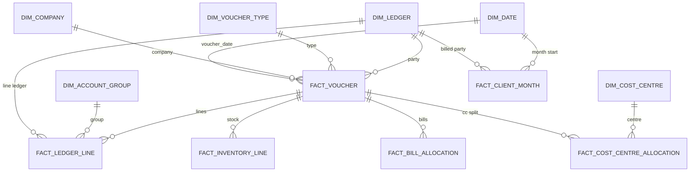

# Tally DW data model

Schema: `tally_dw`.

This is the **billed analytics warehouse** for Tally Prime. It loads only from `tally_ods` (never from Tally XML, and never into `orion_ods` / `orion_dw`). Dimensions are **SCD Type 2**. Facts version when the source voucher or line changes, and lock dimension keys to the **voucher date** (point-in-time).

Browse and refresh live under **Data → Tally Prime → Tally warehouse**. Browse requires `tally_dw_access`; loads require `tally_dw_write`. Both are independent of Tally ODS (`tally_access` / `tally_write`) and of Orion ODS/DW.

See also [tally_ods_data_model.md](tally_ods_data_model.md) for the working copy this warehouse is built from.

## Why this store exists

`tally_ods` is the latest books: GL grain, Tally signs, names overwritten in place. Dashboards should not re-implement “party amount is negative, income is positive, GST is CGST+SGST” on every chart.

`tally_dw` is the picture for billed revenue:

- Masters keep history when a ledger, group, or cost centre changes in Tally.
- Each invoice is one fact row with invoice value, revenue ex GST, GST split, and income mix.
- Client × month is a first-class fact (the analysis grain already used in SQL).
- Orion plan/people/fleet stay in `orion_ods` / `orion_dw`. Join later through a mapping table (`ledger_sk → client_code`, `cost_centre_sk → case_code`), not by display name.

## How to read this store

Every versioned table follows the same conventions:

| Column | Meaning |
|--------|---------|
| `*_dw_sk` | Warehouse surrogate. New on every version. |
| `source_sk` / `source_*_sk` / `source_key` | Natural key for SCD. Stable `tally_ods` surrogate (or `company \| client \| month` for Client Month). |
| `natural_key` | Tally idempotency key copied from ODS, for tracing. |
| `effective_from` / `effective_to` | Version window. `effective_to` is NULL while current. |
| `is_current` | TRUE on the open version. Previews show these rows. |
| `is_expired` | TRUE when the source row left Tally ODS. |
| `source_created_timestamp` / `source_last_updated_timestamp` | Copied from ODS. |
| `dw_created_timestamp` / `dw_last_updated_timestamp` | When this warehouse version was written. |

A unique **current** index on the natural key means there is at most one open row per Tally object. Unchanged ODS rows are not rewritten (`unchanged` in load stats). Changed attributes close the old row and insert a new one (`versioned`). Rows that disappear from ODS are marked expired (`expired`).

`dim_date` is a calendar, not SCD2.

### Point-in-time keys

Facts do **not** join to “whatever ledger is current today”. They store `*_sk` values for the dimension version that was current on `voucher_date` (or `month_start` for Client Month). Lookup is `(company_name, name)` against dimension history.

Optional vouchers (`is_optional = true`) are excluded from every fact.

### Ledger class

`dim_ledger.ledger_class` (and `fact_ledger_line.ledger_class`) is derived from the Tally parent group:

| `ledger_class` | Parent group |
|----------------|--------------|
| `client` | Sundry Debtors |
| `income` | Direct Incomes, Indirect Incomes, Sales Accounts |
| `expense` | Direct Expenses, Indirect Expenses |
| `tax` | Duties & Taxes |
| `cash` | Cash-in-Hand, Bank Accounts |
| `asset` | Fixed Assets, Current Assets |
| `liability` | Sundry Creditors, Current Liabilities |
| `other` | anything else |

### Amounts on sales invoices

In these books, party (Sundry Debtors) lines are typically `is_deemed_positive` with a **negative** `amount`. Income and tax lines are the other side with a **positive** `amount`.

Warehouse measures already apply that convention. Mix and GST columns are **0**, not NULL, when a voucher has no matching lines.

- `invoice_value_incl_gst` = `-SUM(party line amounts)`
- `revenue_ex_gst` = `SUM` of lines whose ledger parent is an income group
- `gst` = Duties & Taxes; `cgst` / `sgst` = ledgers named CGST / SGST
- Mix columns match income ledger names: Man Power Supply, Rental Service of Vehicles…, Service Charges Recivable (Tally spelling), EPF%, ESIC%, and residual SECURITY% / Science Collage%

Sales document types: **Sales**, **Credit Note**, **Debit Note**.

Indian FY on dates is **April–March**: `fy_start_year`, `fy_month_number` (1 = April), `month_year` (`YYYY-MM`).

## Refresh order

Date → Company → Account Group → Ledger → Cost Category → Cost Centre → Voucher Type → Currency → Unit → Godown → Stock Group → Stock Category → Stock Item → GST Classification → Tax Unit → Attendance Type → Voucher → Ledger Line → Inventory Line → Bill Allocation → Cost Centre Allocation → Client Month.

Load from **Data → Refresh Tally warehouse** (WriteGate). Schema is applied on API startup and before each load.

## Dimensions

| Table | UI name | Grain | Notes |
|-------|---------|-------|--------|
| `dim_date` | Date | one calendar day (`date_sk` = `YYYYMMDD`) | 2015-01-01 through current year + 3. FY Apr–Mar, `is_month_end`, `is_weekend`. |
| `dim_company` | Company | one Tally company | Books-from, GST on, state. |
| `dim_account_group` | Account Group | one group | Parent group name. |
| `dim_ledger` | Ledger | one ledger | `ledger_class`, mailing name, pincode, opening/closing balance, tax type. Clients = `ledger_class = 'client'`. |
| `dim_cost_category` | Cost Category | one category | |
| `dim_cost_centre` | Cost Centre | one centre | Parent + category. Closest Orion analogue is a case — map later, do not name-match. |
| `dim_voucher_type` | Voucher Type | one type | Sales / Payment / Journal / … |
| `dim_currency` | Currency | one currency | |
| `dim_unit` | Unit | one UOM | |
| `dim_godown` | Godown | one godown | |
| `dim_stock_group` | Stock Group | one group | May be empty in a manpower company. |
| `dim_stock_category` | Stock Category | one category | May be empty. |
| `dim_stock_item` | Stock Item | one item | |
| `dim_gst_classification` | GST Classification | one HSN class | `hsn_code`, `gst_rate`. |
| `dim_tax_unit` | Tax Unit | one tax unit | |
| `dim_attendance_type` | Attendance Type | one type | May be empty until payroll vouchers are in ODS. |

## Facts

| Table | UI name | Grain | Natural key |
|-------|---------|-------|-------------|
| `fact_voucher` | Voucher | one voucher | `source_voucher_sk` |
| `fact_ledger_line` | Ledger Line | one GL line | `source_ledger_entry_sk` |
| `fact_inventory_line` | Inventory Line | one stock line | `source_inventory_entry_sk` |
| `fact_bill_allocation` | Bill Allocation | one bill ref on a line | `source_bill_allocation_sk` |
| `fact_cost_centre_allocation` | Cost Centre Allocation | one CC split on a line | `source_cost_centre_alloc_sk` |
| `fact_client_month` | Client Month | one billed party × calendar month | `company \| party \| month_start` |

### `fact_voucher`

Header plus billed measures. All non-optional vouchers (not only Sales). `is_sales_document` is true for Sales / Credit Note / Debit Note.

PIT keys: `date_sk`, `company_sk`, `voucher_type_sk`, `party_ledger_sk`.

Measures: `invoice_value_incl_gst`, `revenue_ex_gst`, `gst`, `cgst`, `sgst`, `manpower_supply`, `vehicle_rental`, `service_charges`, `epf_billed`, `esic_billed`, `other_income`, `ledger_line_count`.

### `fact_ledger_line`

Every GL line on a kept voucher. `line_role` is `party` / `income` / `tax` / `expense` / `other`. Debit/credit columns are absolute amounts from `is_deemed_positive`.

PIT keys: header keys plus `line_ledger_sk`, `account_group_sk`.

### `fact_inventory_line`

Stock lines. In the current books, item name and amount are often blank in ODS; rows still load so inventory analysis works if Tally starts sending them.

### `fact_bill_allocation`

Bill-wise references (New Ref / Agst Ref) hanging off a ledger line.

### `fact_cost_centre_allocation`

Cost-centre split of a ledger line. Not every income line is allocated; residual is company-level.

### `fact_client_month`

The analysis grain: billed party (`voucher.party_ledger_name`) × month, **Sales types only**. Same measures as the voucher, summed. `voucher_numbers` and `cost_centres` are distinct lists. `fy_start_year` uses the month start, not a raw voucher date (PostgreSQL `GROUP BY` requires that).

PIT keys: `date_sk` (month start), `company_sk`, `client_sk` (ledger version of the party as of month start).

## Views

| View | Meaning |
|------|---------|
| `tally_dw.v_current_client` | Current Sundry Debtor ledgers (`ledger_class = 'client'`). |
| `tally_dw.v_current_sales_voucher` | Current sales / credit / debit documents. |

## How tables connect



## What this is not

- Not a load into `orion_ods.case_transaction`. Mapping and a billed-vs-expected dashboard come after this warehouse.
- Not collections, payroll, or payments until those voucher types exist in `tally_ods`.
- Not outstanding AR as-of month end. Debtor `closing_balance` on `dim_ledger` is the ODS snapshot at load time, versioned when it changes.

## Typical queries

Revenue by client and month (current versions only):

```sql
SELECT month_year, fy_start_year, client_name,
       invoice_count, invoice_value_incl_gst, revenue_ex_gst, gst,
       manpower_supply, vehicle_rental, service_charges, cost_centres
FROM tally_dw.fact_client_month
WHERE is_current
ORDER BY month_start, client_name;
```

One invoice with mix:

```sql
SELECT voucher_date, voucher_number, party_ledger_name,
       invoice_value_incl_gst, revenue_ex_gst, gst, cgst, sgst,
       manpower_supply, vehicle_rental, service_charges, epf_billed, esic_billed
FROM tally_dw.v_current_sales_voucher
ORDER BY voucher_date, voucher_number;
```
