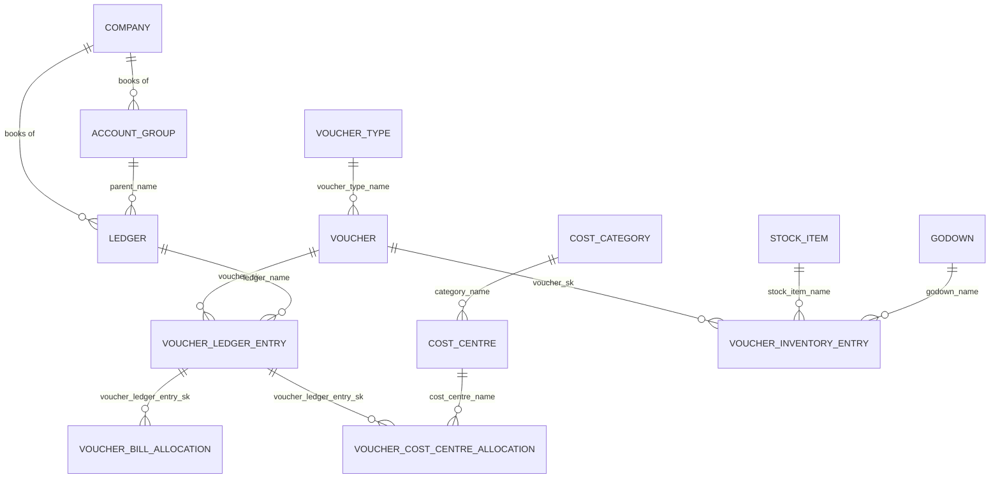

# Tally ODS data model

Schema: `tally_ods`.

This is a **working copy of Tally Prime**, loaded from the XML server on `127.0.0.1:9000`. It is **SCD Type 1**: each load overwrites attributes in place so the table always matches the latest Tally books. It is not Orion operational data (`orion_ods`) and not the Orion warehouse (`orion_dw`). The Tally warehouse (`tally_dw`, SCD Type 2) is loaded from this schema — see [tally_dw_data_model.md](tally_dw_data_model.md).

Load and preview live under **Data → Tally Prime → Working copy**. Browse requires `tally_access`; loads require `tally_write`. Both are independent of Tally DW (`tally_dw_access` / `tally_dw_write`) and of Orion ODS/DW.

## How to read this store

Every table follows the same conventions:

| Column | Meaning |
|--------|---------|
| `*_sk` | Surrogate key. Assigned once, never reused. Use this to join and (later) to version into Tally DW. |
| `natural_key` | Idempotency key from Tally (`company \| GUID` or `company \| REMOTEID`). Hidden in most previews. |
| `company_name` | Tally company the row came from. Currently one company. |
| `tally_guid` / `remote_id` / `tally_master_id` / `tally_alter_id` | Tally's own identifiers. Prefer `*_sk` inside Orion; keep these to trace back to Tally. |
| `source_hash` | Hash of business columns. Unchanged Tally rows are not rewritten. |
| `created_timestamp` | First time Orion saw this natural key. |
| `last_updated_timestamp` | Last time attributes actually changed. |

A reload that finds the same Tally object **keeps the same `*_sk`**. Rows that disappear from Tally are deleted from the working copy.

### Grain

- **Masters** — one row per Tally object (ledger, group, cost centre, …).
- **Voucher** — one row per voucher (invoice, payment, journal, …).
- **Voucher children** — one row per line on a voucher (ledger line, stock line, bill allocation, cost-centre split).

### Amounts

Tally stores signed amounts plus `is_deemed_positive` (Yes = debit side in Tally's sense). Do not `SUM(amount)` across mixed ledgers and treat it as “revenue”. Always slice by ledger parent group, voucher type, or cost centre.

On sales invoices in this company, party (Sundry Debtors) lines are typically deemed positive; income and tax lines are the other side.

### How tables connect

Master-to-transaction links in ODS are **by name**, not foreign keys (except voucher children → voucher). Join `ledger.name` to `voucher_ledger_entry.ledger_name`, and so on.

---

## Masters

### Company — `tally_ods.company`

**Grain:** one row per Tally company.

**What it holds:** The books you are connected to: name, financial year start (`starting_from`), books-from date, state, country, and whether GST is enabled.

**Use for analysis:** Filter and date bounds. `books_from` / `starting_from` tell you the earliest voucher date that is meaningful. `gst_on` tells you whether GST lines on invoices are expected.

**Typical join:** none required; `company_name` is denormalised onto every other table.

---

### Account Group — `tally_ods.account_group`

**Grain:** one row per Tally account group (chart of accounts folder).

**What it holds:** Group name and parent group. Examples: Sundry Debtors under Current Assets, Direct Incomes, Indirect Expenses, Duties & Taxes.

**Use for analysis:** Classify ledgers without hard-coding names.

- Revenue ledgers sit under **Direct Incomes** / **Sales Accounts** / **Indirect Incomes**.
- Customer ledgers sit under **Sundry Debtors**.
- Cost ledgers sit under **Indirect Expenses** (and similar expense groups).
- Tax ledgers sit under **Duties & Taxes**.

Join to ledgers on `ledger.parent_name = account_group.name`. Walk `parent_name` if you need a roll-up (e.g. all Current Assets).

---

### Ledger — `tally_ods.ledger`

**Grain:** one row per Tally ledger (the actual account: a customer, a bank, “Service Charges”, “GST”, “Cash”, …).

**What it holds:** Name, parent group, mailing name, opening and closing balance, bill-wise flag, revenue flag, tax type, country, pincode.

**Use for analysis:** This is the **chart of accounts + party master**.

| `parent_name` (in this company) | Treat as |
|--------------------------------|----------|
| Sundry Debtors | Customers / clients (closest Tally equivalent of Orion `client`) |
| Direct Incomes / Sales Accounts / Indirect Incomes | Revenue accounts |
| Indirect Expenses | Expense accounts (closest to Orion `expense_type` + expense amounts) |
| Duties & Taxes | GST / tax |
| Fixed Assets | Asset register, not P&L |
| Cash-in-Hand / Bank Accounts | Cash position |
| Current Liabilities | Statutory or other payables |

`closing_balance` is the **current** Tally balance (SCD1). It is useful for “what does Tally show today?”, not for a monthly trend — use voucher lines for trends.

`is_bill_wise` marks parties whose balances are tracked invoice by invoice (see **Voucher Bill Allocation**).

---

### Cost Category — `tally_ods.cost_category`

**Grain:** one row per cost category (the axis you allocate costs/revenue on).

**What it holds:** Category name only.

**Use for analysis:** In this company, allocations on vouchers carry a `category_name`. Use this table as the list of valid axes (for example primary vs payroll-related categories). Join to cost centres on `cost_centre.category_name`.

---

### Cost Centre — `tally_ods.cost_centre`

**Grain:** one row per cost centre (site / job / internal bucket).

**What it holds:** Name, parent, category.

**Use for analysis:** This is the closest Tally equivalent of an Orion **case / site**. In the current books, centres look like field sites (CHC locations, manpower supply jobs) plus internal buckets (EPF, service charges).

Revenue and cost by site: join `voucher_cost_centre_allocation.cost_centre_name` to `cost_centre.name`, then to `voucher` for dates. That is the right path for “how much did this site bill?” once allocations exist on the invoice.

---

### Voucher Type — `tally_ods.voucher_type`

**Grain:** one row per voucher type (Sales, Payment, Receipt, Journal, Payroll, …).

**What it holds:** Type name and parent type.

**Use for analysis:** Restrict facts by nature of the document.

| Type | Typical meaning |
|------|-----------------|
| Sales | Outward invoices (revenue) |
| Purchase | Inward bills |
| Receipt | Money in |
| Payment | Money out |
| Journal | Adjustments, payroll postings, non-cash |
| Credit Note / Debit Note | Reversals and extras on invoices |
| Payroll / Attendance | Employee cost and attendance |
| Contra | Bank/cash movement, not P&L |

This company currently has **Sales** vouchers only. The other types are in the master so they fill automatically when Tally has them.

---

### Currency — `tally_ods.currency`

**Grain:** one row per currency defined in the company.

**What it holds:** Display name, original name, mailing name.

**Use for analysis:** Confirm books are INR (or mixed). Amounts in voucher tables are in the company currency; there is no FX table yet.

---

### Unit — `tally_ods.unit`

**Grain:** one row per unit of measure (Nos, Kg, …).

**What it holds:** Name, original name, decimal places.

**Use for analysis:** Decode `actual_qty` / `billed_qty` on inventory lines (those columns are still Tally text, e.g. `1.00 Nos`). Use this list if you later split quantity and unit.

---

### Godown — `tally_ods.godown`

**Grain:** one row per warehouse / location for stock.

**What it holds:** Name and parent godown.

**Use for analysis:** Stock movement by location, joined from `voucher_inventory_entry.godown_name`. Manpower businesses often have little or no warehouse activity; the table is still loaded so inventory analysis works if stock is used.

---

### Stock Group — `tally_ods.stock_group`

**Grain:** one row per stock group (folder in the item tree).

**What it holds:** Name and parent.

**Use for analysis:** Roll up stock items (services vs materials). Empty until Tally has named groups.

---

### Stock Category — `tally_ods.stock_category`

**Grain:** one row per stock category (alternate classification of items).

**What it holds:** Name and parent.

**Use for analysis:** Same as stock group, second axis. Empty until Tally has named categories.

---

### Stock Item — `tally_ods.stock_item`

**Grain:** one row per stock item (SKU or billed service line in Tally inventory).

**What it holds:** Name, parent group, base unit, closing quantity/value as Tally reports it.

**Use for analysis:** What was invoiced as inventory (service items on sales invoices). Join to `voucher_inventory_entry.stock_item_name` for quantity and amount by item over time. `closing_balance` is the current snapshot only.

---

### GST Classification — `tally_ods.gst_classification`

**Grain:** one row per GST/HSN classification master.

**What it holds:** Name, HSN code, GST rate when Tally exports them.

**Use for analysis:** Tax-rate reference. Invoice-level GST in this extract currently lives on **ledger lines** (Duties & Taxes ledgers), not as a forced join to this table. Use classifications when HSN/rate reporting is needed and the fields are populated.

---

### Tax Unit — `tally_ods.tax_unit`

**Grain:** one row per GST registration / tax unit in the company.

**What it holds:** Tax unit name.

**Use for analysis:** Multi-GSTIN companies split books by tax unit. With one GST unit this is a sanity check (`gst_tax_unit_count` on company should match).

---

### Attendance Type — `tally_ods.attendance_type`

**Grain:** one row per payroll attendance type (Present, Overtime, …).

**What it holds:** Name and parent.

**Use for analysis:** Needed when Payroll/Attendance vouchers exist. Currently empty in these books. Future: attendance days by employee once payroll vouchers are loaded.

---

## Transactions

### Voucher — `tally_ods.voucher`

**Grain:** one row per Tally voucher (one invoice, one payment, one journal).

**What it holds:** Date, type, number, party ledger, narration, reference, invoice flag, Tally `remote_id`.

**Use for analysis:** Header grain for **document counts, invoice register, and time series**.

- Revenue register: `voucher_type_name = 'Sales'` (and Credit Note as negative).
- Activity over time: `date_trunc('month', voucher_date)`.
- Customer activity: `party_ledger_name` (join to `ledger` where parent is Sundry Debtors).

Do **not** take revenue from this table alone — there is no header amount. Amounts are on **Voucher Ledger Entry** (and optionally inventory / cost-centre allocations).

`is_optional` marks optional vouchers Tally may exclude from final books; filter them out for statutory-style totals unless you have a reason to include them.

---

### Voucher Ledger Entry — `tally_ods.voucher_ledger_entry`

**Grain:** one row per accounting line on a voucher (party, income, GST, round-off, …).

**What it holds:** Line number, ledger name, signed amount, deemed-positive flag, party-ledger flag. `voucher_sk` points at the header.

**Use for analysis:** This is the **general ledger fact** — the main table for money.

Examples:

- **Invoice value (party side):** lines with `is_party_ledger` or ledgers whose parent is Sundry Debtors.
- **Income:** lines whose ledger parent is Direct Incomes / Sales Accounts.
- **GST collected:** lines whose ledger parent is Duties & Taxes.
- **P&L by month:** join to `voucher` for `voucher_date`, to `ledger` for `parent_name`, then sum `amount` with a consistent sign rule (e.g. income as `-amount` if Tally credits income, or filter `is_deemed_positive`).

One sales invoice produces many lines (party + service income + CGST/SGST + cess, etc.). Count invoices from **Voucher**, not from this table.

---

### Voucher Inventory Entry — `tally_ods.voucher_inventory_entry`

**Grain:** one row per stock/service item line on a voucher.

**What it holds:** Item name, godown, actual qty (Tally text), billed qty, rate, amount.

**Use for analysis:** **What was billed**, when inventory/service items are used on invoices — quantity, rate, and line amount by item. Join to `voucher` for date and party, to `stock_item` for the item master.

If a voucher is accounting-only (no item lines), this table has no rows for that voucher. In the current books, sales invoices do have inventory lines (one per invoice in the last load).

---

### Voucher Bill Allocation — `tally_ods.voucher_bill_allocation`

**Grain:** one row per bill-wise split on a ledger line (which invoice a receipt/payment/credit is applied to).

**What it holds:** Bill name, bill type, amount, parent ledger line and voucher.

**Use for analysis:** **Outstanding and collections.** On invoices, allocations often repeat the invoice number (New Ref). On receipts, they point at the invoices being settled (Agst Ref).

- Outstanding: bill-wise balances on Sundry Debtors (complement `ledger.closing_balance` for bill-wise parties).
- Collection efficiency: receipts whose `bill_name` matches sales `voucher_number`.

Until Payment/Receipt vouchers exist in Tally, this table will mostly show the invoice-side references, not settlements.

---

### Voucher Cost Centre Allocation — `tally_ods.voucher_cost_centre_allocation`

**Grain:** one row per cost-centre (and category) split of a ledger line.

**What it holds:** Category name, cost centre name, amount, parent ledger line and voucher.

**Use for analysis:** **P&L by site / job** — the Tally equivalent of Orion case-level revenue and cost.

Join to `voucher` (date, type, party) and `cost_centre` (site). Sum `amount` for income ledgers vs expense ledgers to get contribution by centre.

If a ledger line is not allocated to a cost centre, it will not appear here. Totals by cost centre can therefore be **less than** company-level income; treat unallocated as a residual (company total minus allocated).

---

## Analysis starting points

Work in this order:

1. **Who are the customers?** `ledger` where `parent_name = 'Sundry Debtors'`.
2. **What sites exist?** `cost_centre`.
3. **What billed, when, to whom?** `voucher` (Sales) + `party_ledger_name`.
4. **How much?** `voucher_ledger_entry` joined to `ledger` (income vs tax vs party).
5. **How much by site?** `voucher_cost_centre_allocation` joined to income/expense ledgers.
6. **What was the line item?** `voucher_inventory_entry`.

Map to Orion later (not loaded automatically):

| Tally ODS | Orion ODS |
|-----------|-----------|
| Ledger (Sundry Debtors) | `client` |
| Cost centre | `case` |
| Sales voucher + income lines | `case_transaction` |
| Expense ledgers / payment lines | `expense_transaction` |
| Payroll vouchers (when present) | `employee_transaction` |

## Reloading

Data → Tally Prime → **Load Tally ODS** (all tables or one table). Masters first, then vouchers, then child line tables. The working copy is always the latest Tally extract, with stable surrogate keys for the future Tally DW.
