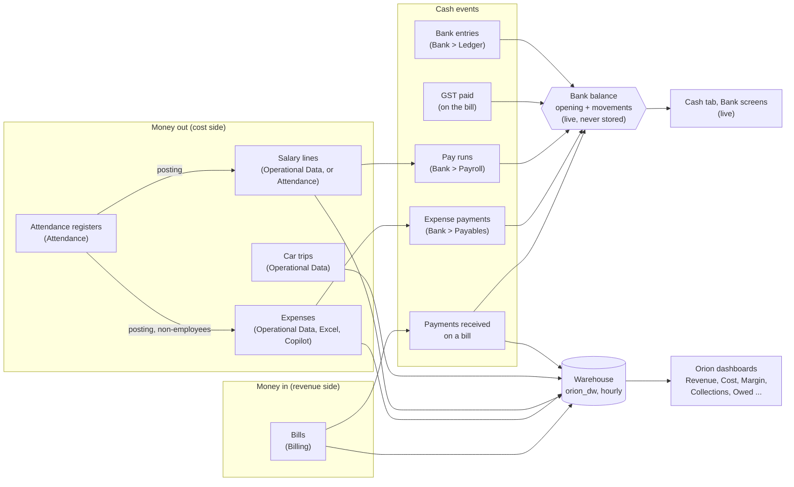
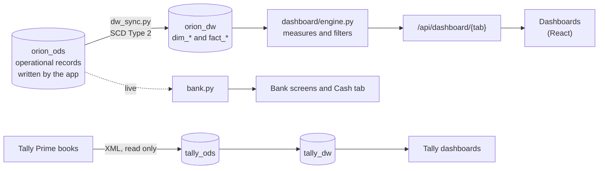

# How money works in Orion: from a record to a dashboard figure

A knowledge-transfer guide. It answers one question step by step: **where does each rupee of revenue and cost come from, how does it move, and how does it end up
as a number on a dashboard?** It is written to be read by someone new to Orion, and every statement was checked against the code (the file names say where to look).

It complements [money-flow.md](money-flow.md) (the controls, the bank and the review of gaps) and [features.md](features.md) (the rules of every feature). This guide
adds what those two do not put in one place: the doors by which money enters Orion, and the road from a record to a dashboard figure.

**Contents**
1. [The answer in one page](#1-the-answer-in-one-page)
2. [The four doors: who writes what](#2-the-four-doors-who-writes-what)
3. [Revenue, step by step](#3-revenue-step-by-step)
4. [Costs, step by step](#4-costs-step-by-step)
5. [Paying a cost: how it reaches the bank](#5-paying-a-cost-how-it-reaches-the-bank)
6. [The bank](#6-the-bank)
7. [From a record to a dashboard: the warehouse](#7-from-a-record-to-a-dashboard-the-warehouse)
8. [The dictionary: every money figure on the dashboards](#8-the-dictionary-every-money-figure-on-the-dashboards)
9. [Why the numbers differ between screens](#9-why-the-numbers-differ-between-screens)
10. [A worked example, including attendance](#10-a-worked-example-including-attendance)
11. [What Orion does not do (say so plainly)](#11-what-orion-does-not-do)
12. [Questions a client will ask, and the answers](#12-questions-a-client-will-ask)

---

## 1. The answer in one page

Orion is **not a general ledger**. It keeps no double entries and no chart of accounts. Money lives in a handful of record types, **each written by exactly one
piece of code**, and everything else (the bank balance, the receivables list, every dashboard figure) is **calculated from those records** and never typed twice.



The four sentences to remember:

1. **Revenue is only ever a bill.** The dashboards' *Revenue* is the taxable value of issued bills (before GST, less credit notes), in the month the service was for. A
   bank entry is never revenue.
2. **Cost is three things on the dashboards:** expenses, salary and (separately, on its own tab) fleet. *Margin = Revenue − Expenses − Payroll.*
3. **Cash is a different question from revenue.** Cash is what was actually received and paid, with GST; it lives on the bank and the Collections tab.
4. **The dashboards read a copy** (the warehouse), refreshed at most an hour behind. The bank screens are live.

---

## 2. The four doors: who writes what

Every money record has one writer. If you remember nothing else for a review of the code, remember this table.

| Door | Screen | Code | It writes |
|---|---|---|---|
| **Billing** | Utility > Billing | `billing.py` | `bill`, `bill_version`, `bill_counter`; the **revenue lines** of a bill (`case_transaction` with a `bill_code`); payments received; `bill_payment_deduction` (TDS and the like); `bill_gst_payment` |
| **Credit notes** | Utility > Credit notes | `credit_notes.py` (and `billing.apply_credit`) | `credit_note`; the credited figures on a bill |
| **Operational Data** | Data > Orion data | `entity_service.py` over `entities.py` (the screen forms, Excel upload and the Copilot all go through it) | `expense_transaction`, `employee_transaction` (salary lines), `car_transaction`, `emd`, and the other business records (clients, cases, employees...) |
| **Attendance** | Utility > Attendance | `attendance.py` | `attendance_*` and, when posted, salary lines and expense lines (they carry `attendance_line_id` and are then locked in the generic forms) |
| **Payables** | Bank > Payables | `payables.py` | `expense_payment` (a payment against an expense) |
| **Payroll** | Bank > Payroll | `payroll.py` | `salary_run` (a month's salary paid by one transfer) and the *paid* state of a salary line |
| **Bank** | Bank | `bank.py`, `bank_statement.py`, `bank_match.py` | `bank_account`, `bank_entry`, statement lines and matches |

Three rules protect this:

- A revenue line that has a `bill_code` belongs to its bill; only `billing.py` writes it. The generic Transaction form, the Excel upload and the Copilot cannot create
  or change one.
- A received-money line (status Committed) **must** have a bill (a database trigger refuses it otherwise). Money with no bill is a bank entry of kind
  `other_receipt`.
- A salary line is marked paid only by a pay run; an expense is paid only by a recorded payment. Nothing flips a "paid" flag by hand.

---

## 3. Revenue, step by step

### 3.1 Raising a bill (accrual: revenue is earned)

1. A billing user picks a **case** and fills lines (quantity × rate), the charges (EPFO %, ESIC %, service charge %, named extras) and the GST rates. The screen shows a
   live preview (`billing/billCalc.ts`).
2. On Save the server **recomputes every figure** (`billing.compute_bill`), so the customer is billed the server's number. Both calculators are tested against the same
   73 published figures (`backend/tests/bill_vectors.json`).
3. It takes the next number `FY/seq` (for example `2026-27/66`) from a locked counter (`bill_counter`): a number is never reused or changed.
4. It writes the bill (`bill`, version 1) and **one revenue line** in `case_transaction`:
   `status = Prospective`, `transaction_date = bill date`, `transaction_amount = taxable value`, `gst = CGST + SGST`, `amount_after_tax_gst = grand total`.
5. The request carries an `Idempotency-Key` claimed in the same transaction, so a double click or retry cannot create a second bill.

```
Lines total
  + EPFO % of lines total
  + ESIC % of lines total
  + Service charge % of lines total
  + named extra charges (percentage or fixed)
= TAXABLE VALUE                       <- this is "Revenue" on the dashboards
  + CGST % of taxable value
  + SGST % of taxable value
  +/- round-off to the rupee
= GRAND TOTAL                         <- this is "Billed", and what the client pays
```

### 3.2 Changing a bill

- **Edit**: needs a reason, keeps the number, copies the old bill whole into `bill_version`, and rewrites the open revenue line. A bill cannot be edited below what
  was already received.
- **Cancel**: only an unpaid bill; its revenue line becomes Cancelled and drops out of every figure.
- **Credit note / write-off** (`credit_notes.py`): takes money off what is still owed, with the revenue and GST in it, **without changing the bill**. It is made, then
  approved by someone other than its maker (a write-off by an admin). It is applied in one transaction (`billing.apply_credit`) and gets its own number `CN FY/seq`.
  Every reader of "what a bill owes" subtracts it.

### 3.3 Money received (cash)

When a client pays, the user records the payment on the bill (amount received, the day, the account, and any **deductions**: TDS, penalty, rounding):

| Case | What changes in `case_transaction` |
|---|---|
| Pays everything still open | the Prospective line becomes **Committed**, `received_date` is set |
| Pays part | a **new Committed line** for what came in; the Prospective line shrinks to what is left (taxable and GST split in proportion) |
| Pays net of TDS | the Committed line holds cash **plus** what was held back; `bill_payment_deduction` records the TDS (section, rate); the bill closes |

The bill is **settled by cash + deductions**. The bank sees only the cash. A deduction is kept for ever and reversed with its payment, never deleted. TDS held back is
listed in Utility > TDS by financial year and client, to be ticked against the client's Form 26AS.

A payment can be reversed only by an admin with a reason; the row is kept.

### 3.4 GST on the bill

The GST is inside the client's payment but belongs to the government. It is **paid in instalments** (CGST and SGST separately, any number of payments) through
`billing.record_gst_payment`, with a confirmation, the day, the amounts and `seen_paid` (so two people cannot both record it). Each payment is a row in
`bill_gst_payment`, kept for ever and reversed (never deleted). Utility > GST sets the GST on bills against the **input tax credit** (the GST on costs that carry the
supplier's GSTIN and invoice number) to show the net payable, month by month.

### 3.5 Money in the bank that is *not* revenue

A **bank entry** (`bank.py`) is for money with no other record: interest, other income, loans, refunds, owner capital (in); bank charges, tax, PF/ESI, loan repayment,
owner withdrawal (out). It reaches the bank balance and the Cash tab. It is **never revenue**: the dashboards' Revenue reads bills only. Money received with no bill
(an advance or deposit) is a bank entry of kind `other_receipt` with a required note.

### 3.6 What counts as "revenue" on each screen

| Question | Figure | Source | Basis |
|---|---|---|---|
| What did we earn in July? | **Revenue** | `fact_bill.taxable_total − credited_taxable`, issued bills, by **service month** | accrual, before GST |
| What did we bill, with GST? | **Billed** | `grand_total − credited_amount` | accrual |
| What did clients pay us? | **Cash collected** | Committed `fact_case_transaction`: `amount_after_tax_gst − deducted_amount`, by received date | cash, with GST |
| What has been settled? | **Settled** | Committed entries including what was held back (the collection rate uses this) | cash + TDS |
| What is still owed? | **Outstanding / Owed** | bill total − credit notes − settled; aged from the bill date | snapshot |
| How much did clients hold back? | **TDS held back** | `deducted_amount` | cash side |
| What is in the bank? | **Bank balance** | `bank_movement` (live) | cash book |

---

## 4. Costs, step by step

A cost reaches Orion by one of **five doors**. Only the first three are in the dashboards' margin.

### 4.1 Expenses (`expense_transaction`)

Entered in Data > Orion data > Expense Transaction (the form, an Excel upload, or the Copilot with a confirmation).

| Field | Meaning |
|---|---|
| Case, Expense Type | what it was for and where it counts (a case, or "Head office and unallocated" when no case) |
| Transaction Date | the day it is dated (drives the month on the dashboards) |
| Amount, Tax, GST, Amount after tax and GST | pre-GST amount, tax, GST and the total (the total must equal the sum within a rupee) |
| Supplier GSTIN, Supplier invoice no | needed for the GST on it to count as input tax credit |
| Status | **Incurred** (stored as `Committed`: a real cost, owed), **Planned** (`Prospective`: expected, not yet happened; it is in the forecast and cannot be paid yet) or **Cancelled** |
| Pay By | the day it is to be paid (drives the forecast and the Payables ageing) |
| Regular expense | Yes or No (recurring) |

A look-alike (same type, case and amount within a week) is warned about, never blocked.

### 4.2 Salary lines (`employee_transaction`)

One line per employee per month: month (`month_year`), days worked, **salary amount**, and `salary_paid` (No until a pay run pays it; never typed). They are entered in
Data > Orion data > Employee Transaction, **or created by posting an attendance register** (4.3).

### 4.3 Attendance (`attendance.py`)

A **register** is one case and one month with a line per person: days present, the rate for a day, an extra, a deduction and the amount.

```
Amount of a line = days present x rate per day + extra - deduction    (never below zero)
Rate per day (an employee) = monthly salary / days in that month      (so a full month pays exactly the salary)
```

**Posting** a register (it needs the confirmation, the count and total the person saw, and an `Idempotency-Key`) enters the pay once, dated the last day of the month
(or today if the month is not over):

| Person on the register | What is entered | Status |
|---|---|---|
| An **employee** | a **salary line** (`employee_transaction`): the month, days worked, the amount, worked at that case, `salary_paid = No` | not paid |
| A **worker** (casual labour, not an employee) | an **expense** (`expense_transaction`): `Committed`, the expense type chosen on the register, regular = Yes, described "Attendance ATT-... · name · month · n days" | not paid |

A posted register cannot be changed: **reopen** it (possible until anything it entered has been paid or had a payment recorded). Reopening takes the entries back; the
register can be changed and posted again. Paying stays where it is: salary in Bank > Payroll, expenses in Bank > Payables.

### 4.4 Car trips (`car_transaction`)

One row per trip: initial and final odometer (the kilometres are the difference), the car and the driver. The dashboards' **Fleet** tab values them as
`kilometres × the car's per-km price`. **Fleet cost is shown on the Fleet tab only: it is not part of the margin and does not touch the bank.**

### 4.5 Everything that is only in the bank

GST paid to the government, EPFO and ESIC paid on a bill (recorded on the bill, like GST), bank charges, income tax, PF and ESI not tied to a bill, loan repayments and owner withdrawals are **bank entries** or payments recorded on bills. They move the bank
balance and the Cash tab, but they are **not** in the dashboards' Expense or Margin. (An employer's PF or ESI that someone wants in the margin must be entered as an
expense.) An EMD (earnest money for a tender) is kept on its own: it appears on the Pipeline tab as money held by authorities and reaches the bank only if someone records
the deposit and the refund as bank entries.

| Cost | Where it is entered | In dashboard Margin? | In bank balance? |
|---|---|---|---|
| Expense | Expense Transaction | **Yes** (Expense, pre-GST, unless Cancelled) | when a payment is recorded |
| Salary | Employee Transaction, or Attendance | **Yes** (Payroll, by month) | when a pay run is recorded |
| Casual wages | Attendance (a worker) | **Yes** (as an expense) | when a payment is recorded |
| Fleet | Car Transaction | No (Fleet tab only) | No |
| GST paid | the bill, GST payment | No (GST tab and Controls) | when recorded |
| Bank charges, tax, PF/ESI, EMI, owner money | Bank > Ledger | No | when the entry is dated |

---

## 5. Paying a cost: how it reaches the bank

An entered cost is **owed**, not paid. It reaches the bank balance only when a payment is recorded.

| Cost | The paying act | Code | Rows | Effect |
|---|---|---|---|---|
| Expense | Bank > **Payables**: an amount, a day, the account, a reference, in as many instalments as needed | `payables.py` | `expense_payment` | one movement out per payment; the expense reads Unpaid, Part paid or Paid (worked out, never stored) |
| Salary | Bank > **Payroll**: tick the month's lines, the day, the account, the bank reference | `payroll.py` | `salary_run` | **one movement per run**, so one bank transfer matches one movement; the lines become paid |

Controls on both: a confirmation, the amount the person saw (so two people cannot pay twice), no more than is left, not in the future, not before the account's
opening date, an `Idempotency-Key`; reversal needs a reason and the row is kept for ever. A paid expense is never worth less than was paid (a database trigger), and a line
in a pay run cannot be changed or deleted.

---

## 6. The bank

The balance is **never stored**: `balance = opening balance + every movement since the opening date`. The movements are one view, `orion_ods.bank_movement`, that reads the
records where they already live:

| Source in the view | Direction | Read from | Date |
|---|---|---|---|
| Client receipt | in | Committed `case_transaction` (cash only, less held back) | received date |
| Expense payment | out | `expense_payment` (not reversed) | day paid |
| GST paid | out | `bill_gst_payment` (not reversed), one movement per batch | day paid |
| Bank entry | in or out | `bank_entry` (not voided) | entry date |
| Salary | out | `salary_run` (not reversed), one per run | day paid |

Reverse a payment and the balance falls by itself, because the movement disappears from the view. A second view, `bank_expected`, holds what is **known to be coming**
(Prospective revenue, Prospective and unpaid expenses, unpaid salary at month end, estimated GST on the 20th of the next month) and feeds the 30/60/90-day forecast and the
13-week projection.

**Reconciliation** compares the book with the bank's statement: upload the statement (CSV or Excel), Orion reads it, checks the running balance line to line, and
auto-matches a line only when it is certain both ways (same amount to the paisa, same direction, within 5 days, one candidate). Anything doubtful waits for a person.
Three states result: Reconciled, Differences explained, Does not add up. There can be several accounts (bank and cash); a statement belongs to one bank account.

---

## 7. From a record to a dashboard: the warehouse

The Orion dashboards **do not read the operational tables**. They read a copy, `orion_dw`, built by `dw_sync.py`.



**What the load does.** Every table is copied as **SCD Type 2**: a changed row closes its current version and adds a new one; a row deleted in the operational store is
marked `is_expired`. The dashboards read only live versions (`is_current` and not `is_expired`). This is why Orion can answer "what did this look like then?".

**Point in time.** A fact (a bill, an expense, a salary line...) stores the surrogate keys of the case, client, capability and business domain **as they were on the day
of the event**. So a client's state, type and priority on a bill are those of the day it was raised, not today's.

**When it runs.** A background thread inside the API wakes every `ORION_DW_AUTOLOAD_MINUTES` (default 60). It compares a *fingerprint* of the operational data (row counts
and newest change per table, and the number of deletions) with the last successful load, and runs a full load **only if something changed**. A person can run it at once from
the ETL page. Every run is recorded (`etl_run`, `etl_run_step`). "Warehouse last loaded" is shown on the dashboards: it is the **oldest** table's last load.

**What reads what.** Each dashboard figure is built from a *scope*, a warehouse fact joined to its dimensions (`dashboard/filters.py`):

| Scope | Fact (warehouse) | Month is | Used for |
|---|---|---|---|
| bill | `fact_bill` | service month | Revenue, Billed, GST, Owed, ageing, DSO, credit notes |
| revenue | `fact_case_transaction` | transaction date | revenue entries by status (Committed, Prospective, Cancelled) |
| collection | `fact_case_transaction` (Committed) | received date (else transaction date) | Cash collected, Settled, TDS held back |
| expense | `fact_expense_transaction` | transaction date | Expense, input tax credit |
| payroll | `fact_employee_transaction` | `month_year` | Payroll, salary pending, headcount paid |
| fleet | `fact_car_transaction` | driving date | kilometres, Fleet cost |
| opportunity, emd | `dim_opportunity`, `fact_emd` | start / deposit date | Pipeline, EMD held |
| case, employee, contact, car | `dim_*` | as they stand now | rosters |

The **Cash** tab is the exception: it reads the Bank module live (`dashboard/views_cash.py`), only for people with bank access.

---

## 8. The dictionary: every money figure on the dashboards

All defined once in `dashboard/engine.py` and `dashboard/filters.py`.

| Figure | Exact meaning | Tables | Month basis | Before or after GST |
|---|---|---|---|---|
| **Revenue** | Σ (`taxable_total − credited_taxable`) of issued bills | `fact_bill` | service month | before |
| **Billed** | Σ (`grand_total − credited_amount`) | `fact_bill` | service month | after |
| **GST on bills** | Σ (CGST + SGST − credited CGST − credited SGST) | `fact_bill` | service month | the GST |
| **Cash collected** | Σ (`amount_after_tax_gst − deducted_amount`) of Committed entries | `fact_case_transaction` | received date | after |
| **Settled** | Σ `amount_after_tax_gst` of Committed entries (cash + held back) | same | received date | after |
| **TDS held back** | Σ `deducted_amount` | same | received date | n/a |
| **Collection rate** | Settled ÷ Billed, on the dimensions both carry | both | — | — |
| **Credit notes** | Σ `credited_amount` | `fact_bill` | service month | after |
| **Outstanding (Owed)** | Σ max(grand total − credited − settled, 0), a snapshot as at the last load, aged from the bill date into 0-30, 31-60, 61-90, 90+ | `fact_bill`, `fact_case_transaction` | n/a | after |
| **DSO** | Outstanding ÷ billed in the last 90 days × 90 | `fact_bill` | — | — |
| **Expense** | Σ `transaction_amount` of every expense that is not Cancelled (incurred and planned) | `fact_expense_transaction` | transaction date | **before** |
| **Payroll** | Σ `salary_amount` of every salary line (paid or not) | `fact_employee_transaction` | `month_year` | n/a |
| **Salary pending** | Σ `salary_amount` where `salary_paid = No` | same | `month_year` | n/a |
| **Cost** | Payroll + Expense | | | |
| **Margin** | **Revenue − Expense − Payroll**, on the dimensions all three carry | | | |
| **Margin %** | Margin ÷ Revenue | | | |
| **Input tax credit** | Σ GST on Committed expenses that carry the supplier's GSTIN and invoice number | `fact_expense_transaction` | transaction date | the GST |
| **Net GST to pay** | GST on bills − input tax credit (below zero is a credit carried forward) | | | |
| **Fleet cost** | Σ (`driven_km × per_km_price`) | `fact_car_transaction`, `dim_car` | driving date | n/a; **not in margin** |
| **Bank balance** | opening + movements (live) | bank views | — | cash book |

Two details to know when explaining margin: the margin of one case or domain is **before head-office cost**, and a row **"Head office and unallocated"** carries the rest
so the rows add up to the total; and a selection that only one side of a calculation understands (for example a payment-status filter) is ignored for the other sides, so a ratio
is never built from mismatched halves.

---

## 9. Why the numbers differ between screens

They answer different questions and are **allowed to differ**. The first thing to explain to anyone comparing screens:

| Comparison | Why they differ |
|---|---|
| **Revenue** vs **Cash collected** | Revenue is *earned*: bills by the month the service was for, before GST. Cash is *received*: payments by the day they came, with GST, less what the client held back. A July bill paid in September is revenue in July and cash in September. |
| **Billed** vs **Revenue** | Billed includes GST (and round-off). Revenue is the taxable value. |
| **Expense** (dashboard) vs **money out** (bank) | Expense is dated by the cost (before GST, planned costs included). Money out is dated by the payment (what was paid, with GST), plus GST paid, charges and other entries. |
| **Payroll** vs **salary paid** | Payroll counts every salary line in its month, paid or not. The bank sees salary only when a pay run is recorded. |
| **Margin** vs the bank | Margin is an accrual figure. It leaves out fleet, GST paid, bank charges, tax and loans. |
| **Dashboards** vs **Bank screens** | Dashboards are as fresh as the last warehouse load (up to an hour). The bank is live. |
| **Orion** vs **Tally** | Tally is the accountant's books, copied read-only and kept separately. Orion never joins them into one number; the Copilot says which one it is quoting. |

---

## 10. A worked example, including attendance

**Case: a hospital, July 2026.** Service charge 10%, GST 9% + 9%. Lines total 1,00,000.

### Revenue side

| | Amount |
|---|---|
| Lines | 1,00,000 |
| Service charge 10% | 10,000 |
| **Taxable value (Revenue)** | **1,10,000** |
| CGST 9% | 9,900 |
| SGST 9% | 9,900 |
| **Grand total (Billed)** | **1,29,800** |

### Cost side (for the same case and month)

- **Attendance register ATT for July**, posted on 31 July: three employees (salary lines of 18,000 + 16,000 + 15,000 = **49,000**) and two casual workers
  (two expense lines of 6,000 each, expense type "Casual wages" = **12,000**).
- A vendor **expense** of 8,000 (uniforms) entered in Expense Transaction, Incurred, GST 1,440 (total 9,440), supplier GSTIN and invoice given.

### What each screen shows

| Day | Event | Writes | Bank balance | Dashboards (after the next load) |
|---|---|---|---|---|
| 31 Jul | Bill 2026-27/202 raised | `bill`; Prospective line 1,29,800 | no change | Revenue +1,10,000 (July); Billed +1,29,800; Owed +1,29,800 |
| 31 Jul | Attendance posted | 3 salary lines (49,000); 2 expense lines (12,000) | no change | Payroll +49,000; Expense +12,000 |
| 31 Jul | Uniform expense entered | `expense_transaction` 8,000 | no change | Expense +8,000; input tax credit +1,440 |
| | | | | **July margin = 1,10,000 − (12,000 + 8,000) − 49,000 = 41,000 (37.3%)** |
| 5 Aug | Salary paid (pay run, 49,000) | `salary_run` | **−49,000** | Salary pending −49,000 |
| 5 Aug | Casual wages (12,000) and the uniforms (9,440 with GST) paid | 3 `expense_payment` rows | **−21,440** | no change to Expense (the cost was already counted) |
| 12 Sep | Client pays 1,27,600; it held back 2,200 TDS | Committed line 1,29,800; `bill_payment_deduction` 2,200 | **+1,27,600** | Cash collected (Sept) +1,27,600; TDS held back +2,200; Owed −1,29,800 |
| 20 Sep | GST paid, 19,800 | `bill_gst_payment` | **−19,800** | GST unpaid −19,800 |
| 21 Sep | Bank interest credited | `bank_entry` interest | + the interest | Cash tab only. **Not revenue** |

Note what did **not** change July's margin: paying the salary, collecting the money, paying the GST and the interest. Margin moves when a bill, an expense or a salary line
is entered, never when cash moves.

---

## 11. What Orion does not do

Say these plainly in a review; each is a deliberate scope decision or a known next step (see [money-flow.md](money-flow.md) section 12 for the full list).

- **Not double-entry.** There is no chart of accounts or trial balance. Accountants keep the books in Tally, and nothing in Orion measures the difference between Orion and
  Tally; the Copilot and dashboards keep them separate and label each answer.
- **No period close.** A past bill, payment or expense can still be changed (with a reason, a version and an audit trail). There is no month-end lock.
- **GST is output GST with input credit tracked, not a return.** Net GST per month is shown (bills less input credit), but reverse charge, blocked credit, TCS and filing the return
  (GSTR-3B) are not modelled, and the bank forecast still expects the full GST on bills.
- **PF, ESI and statutory dues** are not generated from salary lines. What a bill *charged* for EPFO and ESIC can be marked paid bill by bill (Utility > EPFO and ESIC, and on the bill), and goes through the Bank; it does not change Revenue, but once paid it is a cost (the expense type "EPFO and ESIC paid") on the day paid and lowers Margin, whether or not payroll is entered. Dues not tied to a bill are bank entries, or expenses if someone enters them.
- **Fleet cost is not in margin**, and an **EMD** is not in the bank unless recorded as entries.
- **Bank statements are uploaded by hand** (no bank feed), and matching relies on amount, date and the text on the line.
- **Dashboards are up to an hour behind** (a fingerprint check every 60 minutes); the bank is live.

---

## 12. Questions a client will ask

**Where does revenue come from?** Only from issued bills. Revenue is the bill's taxable value, in the month the service was for.

**Is bank interest or other income revenue?** No. It is a bank entry. It shows in the Bank and the Cash tab, never in Revenue or Margin.

**If a client pays, does revenue go up?** No. Revenue went up when the bill was raised. Payment moves the bill from owed to settled and the bank balance up.

**Where do costs come from?** Expenses, salary lines and attendance. Attendance posts salary lines for employees and expense lines for casual workers. Margin is revenue less
expenses less payroll.

**Is fleet cost in margin?** No. It is on the Fleet tab.

**What happens when I post an attendance register?** For each employee a salary line is created for that month (not paid); for each casual worker an expense is created
(Committed, not paid). Nothing reaches the bank until you pay. Reopen the register to change it, until anything it entered has been paid.

**Why did the bank balance not change when I entered the expense?** An expense is owed, not paid. The balance moves when you record the payment in Bank > Payables.

**What is TDS in Orion?** What the client held back from a payment. The bill is settled by cash plus TDS; the bank sees only the cash; TDS is tracked by year and client for
Form 26AS.

**Why does the dashboard show less cash than the bills?** Cash is by received date and excludes TDS; Owed is what is still open. See section 9.

**Why is a number on the dashboard not what I just entered?** The dashboards read the warehouse, which loads at most an hour behind (run it now from the ETL page).

**Can anything be deleted?** Not money. A bill is versioned or cancelled; a payment, GST payment or pay run is reversed with a reason; a bank entry is voided; every row is
kept with who and when.

**Who can see the bank?** Only people given bank access (admins by default). The Cash tab and the Copilot's bank tools check it too.

**Does the Copilot change money?** It can create or edit operational records only after the person confirms on screen, and it never records a bill payment, a bank entry or a
pay run: those are done on their own screens.

**Does Orion replace Tally?** No. Tally stays the accounting book. Orion is the operational record and reporting layer; the Tally dashboards read a read-only copy of Tally.

**What stops a double click creating two bills?** An `Idempotency-Key`, claimed in the same database transaction as the work.

**What if two people edit the same record?** The second save is refused with "changed by X after you opened it".
