# How money moves through Orion

A guide for the people who run the finances of Prakash Securities (and for anyone who must trust the numbers): where money is
recorded, how it enters and leaves, how the pieces connect, what protects each step, and where the design is thin. Every statement
here is checked against the code; the file names say where to look. [features.md](features.md) has the rules of each feature,
[change-impact.md](change-impact.md) says what else moves when something changes. The diagrams are Mermaid: GitHub draws them, and so do most
Markdown viewers.

**Contents**
1. [The model in one page](#1-the-model-in-one-page)
2. [The vocabulary: states and words that mean different things](#2-the-vocabulary)
3. [Money in: a client invoice from raising it to the bank](#3-money-in-a-client-invoice)
4. [Money out: expenses, salaries, GST and the rest](#4-money-out)
5. [GST: collected, owed, paid](#5-gst-collected-owed-paid)
6. [The Bank: how the balance is made](#6-the-bank-how-the-balance-is-made)
7. [Reconciliation: checking the book against the bank](#7-reconciliation)
8. [Reporting: the same rupee on different screens](#8-reporting-the-same-rupee-on-different-screens)
9. [Controls: who may do what, and what cannot be undone](#9-controls)
10. [A worked example, end to end](#10-a-worked-example-end-to-end)
11. [How the modules are connected](#11-how-the-modules-are-connected)
12. [Assessment and what to improve](#12-assessment-and-what-to-improve)

---

## 1. The model in one page

Orion is **not a general ledger**. It does not post double entries. Money lives in four kinds of record, each with one owner in the code,
and everything else (the bank balance, the dashboards, the receivables list) is **derived** from them and never typed twice.

| Kind of money record | Where it lives | The only code that writes it |
|---|---|---|
| A client **invoice** and what it earns | `bill`, `bill_version`, and its revenue line in `case_transaction` | `billing.py` |
| **Money received** from a client | `case_transaction` rows with status `Committed` (one per payment) | `billing.py` only. Money with no bill is a Bank entry (`other_receipt`) |
| **GST paid** to the government | `bill_gst_payment` (one row per component per instalment) | `billing.py` |
| **Costs**: expenses and salaries | `expense_transaction`, `employee_transaction` | the generic record forms, Excel upload and the Copilot (through `entity_service.py`) |
| **Everything else in the bank**: interest, charges, loans, tax, owner money | `bank_entry` | `bank.py` |

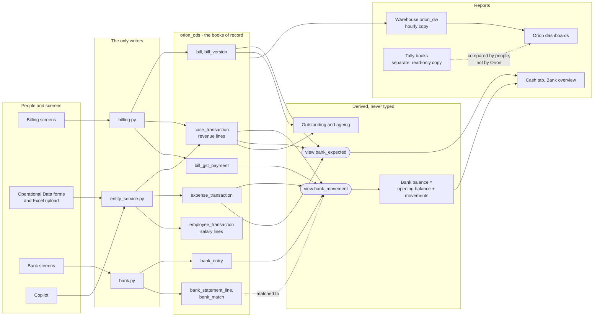

Three ideas carry the whole design:

1. **One fact, one place.** A client's payment is recorded once, on its bill. The bank balance reads it from there. If the payment is reversed
   on the bill, the balance falls by itself. Nothing is copied by hand from one screen to another.
2. **Nothing that matters is overwritten or deleted.** A bill is edited by making a version; a GST payment is reversed, not removed; a bank
   entry is voided with a reason; a statement line is matched or set aside, not erased. The history is part of the data.
3. **The server is the guard, not the screen.** Every rule below (what a payment may be, who may reverse it, that a request is
   processed once) is enforced in the API. The screen only makes the right thing easy.

---

## 2. The vocabulary

The same words mean different things in accounting, in operations and in the code. Orion uses these.

### The three states of a revenue or expense line

`case_transaction` (revenue) and `expense_transaction` (cost) both carry `transaction_status`:

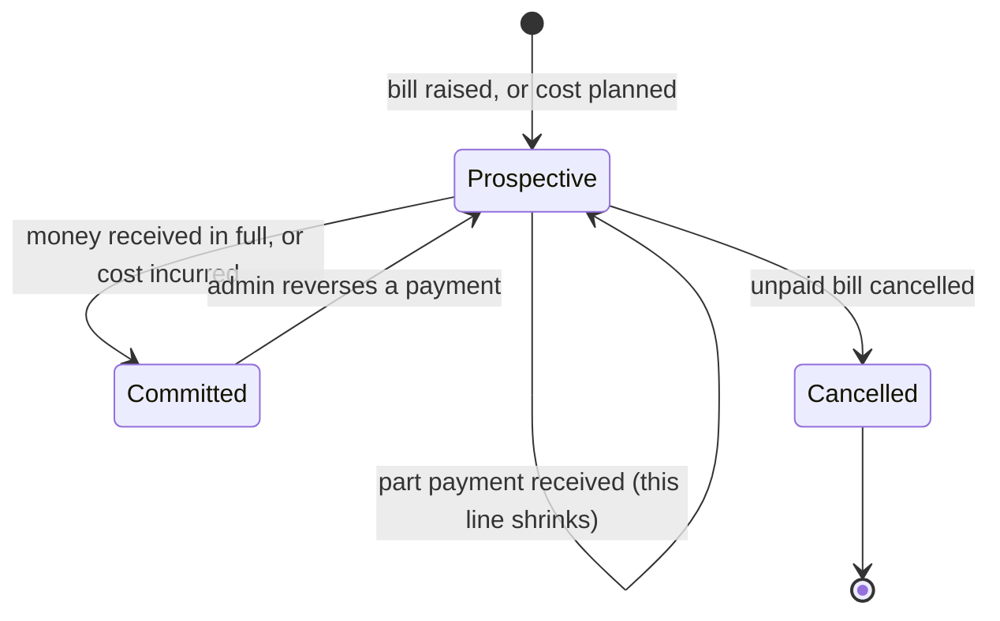

| Status | Meaning | Counts in the bank balance? | Counts in the forecast? |
|---|---|---|---|
| **Prospective** | Expected, not yet happened: what a client still owes on a bill; a cost still to come | No | Yes, on its date |
| **Committed** | Happened: money received from a client; a cost incurred | **Yes** | No |
| **Cancelled** | Withdrawn | No | No |

### Words that are easy to confuse

| Word | What it is in Orion | Basis |
|---|---|---|
| **Revenue** (dashboards) | Taxable value of issued bills, **before GST**, in the month the *service* was for | Accrual, by service month |
| **Billed** | Grand total of issued bills, **with GST** | Accrual |
| **Collected / received** | Committed revenue lines, **with GST**, on the day received | Cash |
| **Outstanding / owed** | Bill grand total less what was received on it; counted from the bill date | Receivable |
| **GST owed** | CGST + SGST on issued bills, less GST payments recorded | Liability |
| **Bank balance** | Opening balance + every movement since the opening date | Cash book, worked out |
| **Expense** (dashboards) | `transaction_amount`, before GST | Accrual |
| **Money out** (bank) | Expense payments (what was paid, on the day, from the account), GST paid, and bank entries | Cash book |
| **Tally figures** | The company's accounting books, copied read-only | Accounting books |

> The Orion dashboards, the bank and Tally answer different questions and are **allowed to differ**. "Revenue" is earned (before GST);
> "Collected" and the bank balance are cash (with GST). See [section 8](#8-reporting-the-same-rupee-on-different-screens).

---

## 3. Money in: a client invoice

### 3.1 From raising a bill to cash in the bank

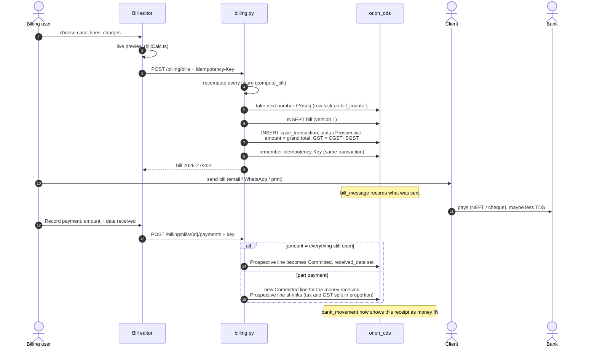

What makes this safe:

- **The number is legal and permanent.** `FY/sequence` is taken from `bill_counter` under a row lock, so two people never get the same
  number, and a number is never changed or reused (even after cancelling).
- **The server recomputes.** The browser's preview (`billCalc.ts`) and the server (`billing.compute_bill`) are tested against the same 73
  published figures (`bill_vectors.json`). The customer is billed the server's figure.
- **A bill and a payment are saved once.** The `Idempotency-Key` is claimed in the same database transaction as the work, so a
  double click, a retry or a stale tab cannot create a second invoice or record a part payment twice.
- **The money always adds up.** A bill has at most one Prospective line (a partial unique index), and its Prospective and Committed lines
  always sum to its grand total. A payment larger than what is open is refused.
- **Edits keep history.** Editing needs a reason, keeps the number, copies the old bill whole into `bill_version`, and re-syncs the
  Prospective line. A bill cannot be edited below what was already received, moved to another case after a payment, or cancelled after
  one.

### 3.2 What a bill is made of (the calculation)

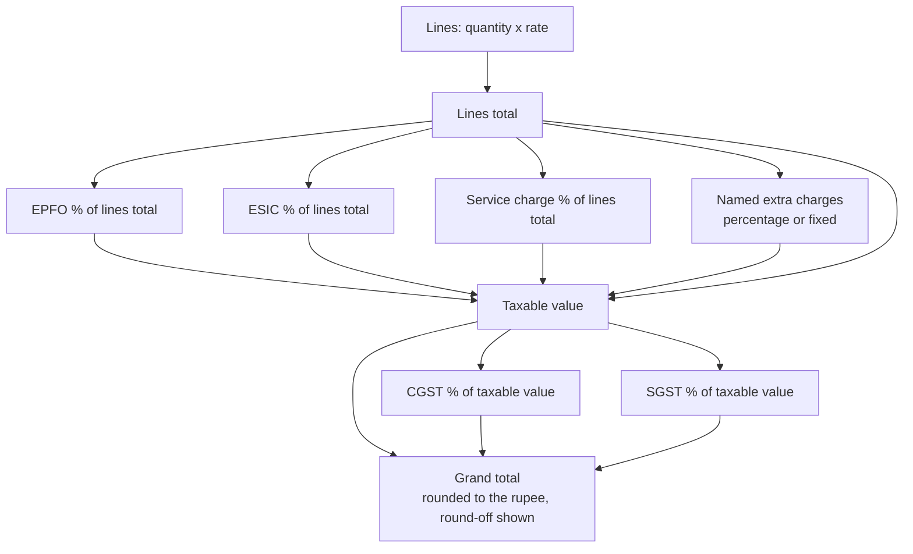

### 3.3 Part payments and the receivables view

A bill is owed from its bill date until paid; its balance is `grand total - Committed receipts`. The Outstanding page buckets it by age from the
bill date (0-30, 31-60, 61-90, over 90 days), and reminders and statements go out by email or WhatsApp (recorded in `bill_message`). Only bills
tagged to a case are counted.

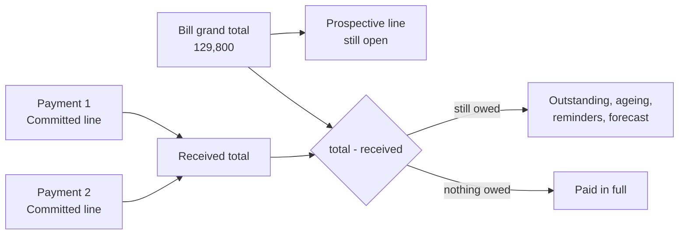

Money received with **no bill** (an advance, a deposit) is not typed into the generic Transaction form, the Excel upload or the Copilot: a
Committed revenue line with no `bill_code` is refused by all three (the database holds the rule, a trigger on `case_transaction`). It is a Bank entry of
kind `other_receipt`, which needs a note saying who paid and why there is no bill, and is voided with a reason like any entry. A Committed line with no
bill that was stored before the rule keeps counting and can be corrected where it stands (so no balance moves); a Prospective or Cancelled line is
unaffected. Lines that belong to a bill are read-only on the Transaction form.

---

## 4. Money out

Four different things take money out, and they are recorded in four different places. Each reaches the bank balance by itself, in its own way.

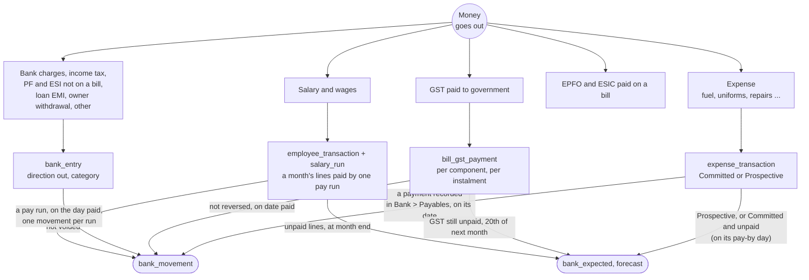

| Outflow | How it is entered | When it hits the bank balance | Protection |
|---|---|---|---|
| **Expense** | Operational Data > Expense Transaction (form or Excel), or the Copilot with a confirmation, enters it (status **Incurred** (stored as `Committed`), with an optional **Pay by** day; it can be entered as already paid by filling in Paid On, Paid From and Payment Reference, which records the payment in the same save). Bank > Payables records what is **paid**: an amount, a day, the account, a reference, in as many instalments as it takes | When a **payment** is recorded, on the day paid, from the account named, for the amount paid. An expense that is incurred and unpaid does not touch the bank; it is owed (Payables, with ageing) and it is in the forecast on its pay-by day | Entry: required fields and number checks, who/when recorded, deletes logged, two people editing one record refused (409). Payment: `confirm`, the amount seen as already paid (`seen_paid`), no more than is left, not future, not before the account's opening date, an `Idempotency-Key`, reversible only with a reason, never deleted. A paid expense stays Committed and never worth less than was paid (a database trigger) |
| **Salary** | Operational Data > Employee Transaction enters one line per employee per month (it starts as not paid: Salary Paid is set by Payroll, never typed in). Bank > **Payroll** marks a month paid: the lines that one bank transfer paid, the day, the account and the bank reference are one **pay run** | When a pay run is recorded, on the day paid, from the account named, for what its lines came to: **one movement per run**, so one transfer on the statement matches one movement. Unpaid lines are in the forecast at the month end | Confirmation, the lines and total the person saw (`seen_count`, `seen_total`), the account named when there are several, not in the future, an `Idempotency-Key`; reversible only with a reason (the lines go back to unpaid), never deleted. A line in a pay run cannot be changed or deleted, and a line cannot be marked paid except through a run (database trigger) |
| **GST to government** | Bill page > GST > Record payment (CGST and/or SGST, a day, a reference) | On the day paid, as one movement per payment recorded together | Confirmation tick, server-side `confirm` and `seen_paid`, no overpaying a component, reversible only with a reason, never deleted |
| **Everything else** | Bank > Ledger > Add entry, or "Record" on a statement line | On the entry date (never future, never before the opening date) | `Idempotency-Key`; void with a reason, never delete; full audit |

**Earnest money (EMD) is not in this picture.** An EMD (Operational Data > EMD) is money the firm deposits for a tender and expects back. Orion keeps its
amount, instrument, status and refund dates and shows what is still out on the Pipeline tab, but **no EMD or refund reaches `bank_movement`**: the bank
balance moves only if someone records the deposit and the refund as Bank entries. This is deliberate for now (recording it twice would be worse than not
at all), and it is why the "EMD held" figure is a position of receivables from authorities, not a bank figure.

**How an expense is paid.** Each payment is a row of `expense_payment` (written only by `payables.py`). An expense is *Unpaid*, *Part paid* or *Paid*
according to the payments that have not been reversed; the status is worked out, never stored. Reversing a payment (with a reason) puts the money back in
the account it left and makes the expense owed again. When payments began, every expense that was Committed was given the one payment the bank had
always assumed (all of it, on its transaction date, in the first account), so no balance moved; an expense entered after that starts unpaid unless it was entered as already paid.

**Tax detail on an expense.** An expense stores `transaction_amount`, `tax`, `gst` and `amount_after_tax_gst` (= sum, checked to within a
rupee). The dashboards' "Expense" uses the pre-GST amount; the bank uses the amount paid including GST.

---

## 5. GST: collected, owed, paid

GST is collected from the client inside the bill total, belongs to the government, and is paid back in instalments.

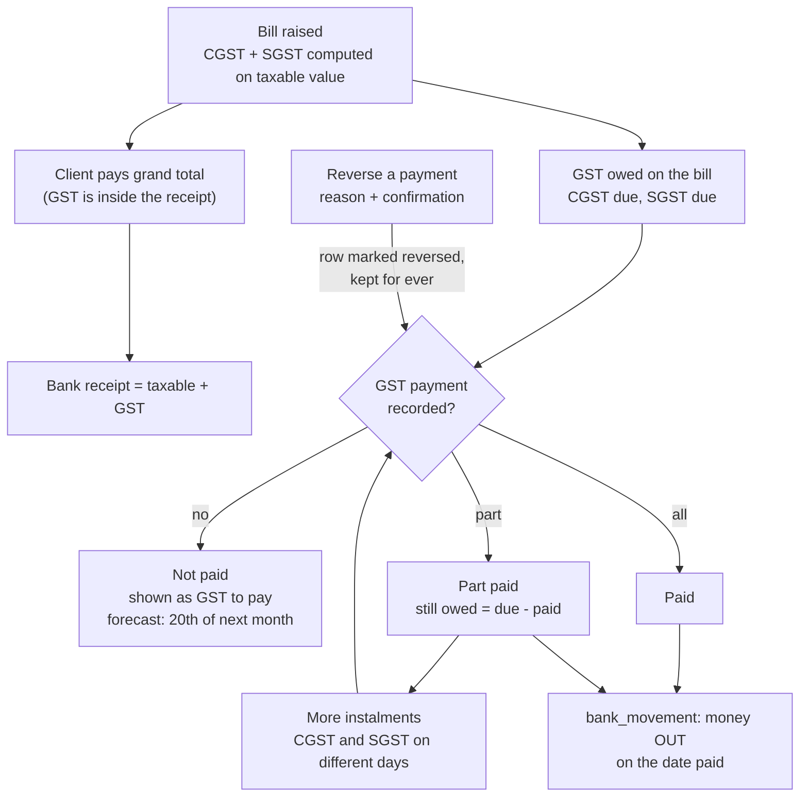

Rules that matter to a finance reader:

- A payment is an amount of CGST, of SGST or of both, on a day, with a challan or payment reference. A bill can have any number.
- **Recording** needs a confirmation naming the bill and total, a day not before the bill date and not in the future, and no more than what is
  left on each component. The request must also carry the amount paid *when the screen was opened* (`seen_paid`); if someone else paid in the
  meantime, nothing is written (409). This also blocks two quick clicks.
- **Reversing** needs a reason (five characters or more) and the same confirmation. The row stays, struck through, with who, when and why.
- An edit cannot take a bill's CGST or SGST below what was paid; a bill with GST paid cannot be cancelled until the payments are reversed.
- The bank forecast estimates unpaid GST as due on the **20th of the month after the bill** (the return due date). This is an estimate, not a
  filing calendar.
- Orion computes **output GST only**. It does not net input tax credit from expenses, so "GST to pay" is gross, not the net payable on the return.

---

## 6. The Bank: how the balance is made

The balance is **never stored**. It is calculated every time from the opening balance and the movements.

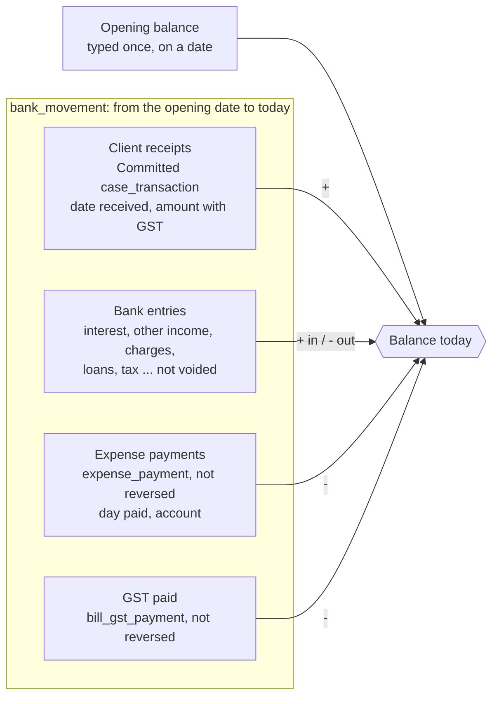

`balance(as of D) = opening_balance + sum(in) - sum(out)` over movements dated from the opening date to D. Money before the opening date is inside
the opening balance and is not counted again. Because the balance is a calculation, it cannot drift from its parts: reversing a payment, cancelling
an expense payment or voiding an entry changes it at once, and the Ledger's running balance is recomputed from the same rows.

### 6.1 Bank entries

A `bank_entry` is for money with **no record elsewhere in Orion**: interest earned, other income, loans, refunds, owner capital (in); bank
charges, tax, GST paid outside a bill, PF/ESI **not paid against a bill** (EPFO and ESIC paid on a bill are recorded on the bill, see below), salary paid outside Orion, loan repayment, owner withdrawal (out).

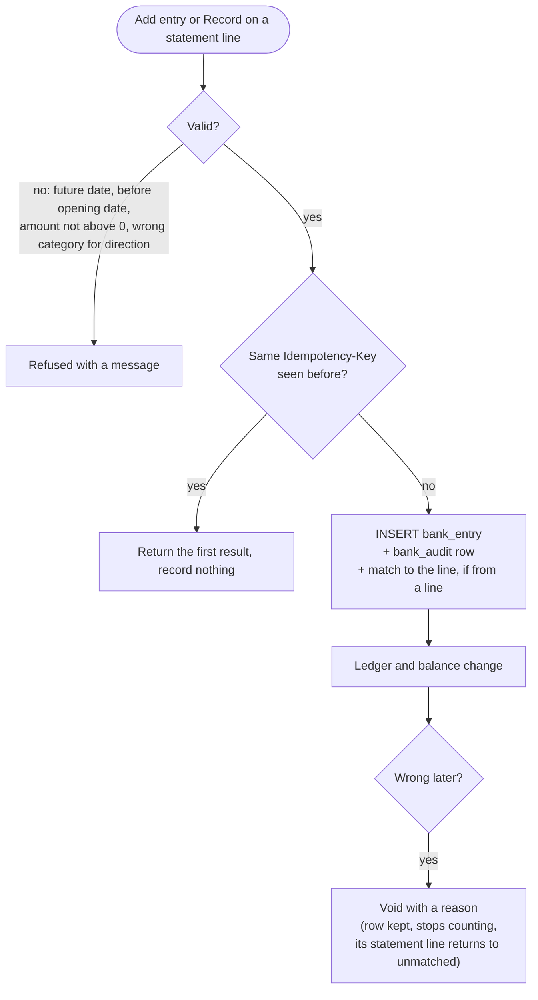

Interest and other income are the categories `interest` and `other_income`. They are summed for the Overview, the Cash dashboard tab and the
Copilot. Loans, refunds and owner capital are deliberately **not** income.

### 6.2 Changing the opening balance

It moves every balance, so it is a deliberate act: the screen shows the balance now and after, the server refuses without `confirm`, the old and new
figures go to the audit history, and the opening date cannot be moved later past a matched statement line.

### 6.3 The forecast

`bank_expected` holds what is known to be coming: Prospective revenue lines (what clients still owe), Prospective expenses on their dates, and
Committed expenses that are still unpaid (what is left, on the pay-by day), plus estimated GST. The page shows the next 30, 60 and 90 days, a 13-week projection, the lowest projected week, and an **overdue** bucket (expected
before today and not yet recorded) that is left out of the projection unless the person ticks "count overdue money". It is only what Orion
already knows; the page says so.

---

## 7. Reconciliation

Reconciliation proves the book against the bank. The person downloads a statement from the bank's website (CSV or Excel), and Orion compares it line
by line with the book.

### 7.1 From file to matched lines

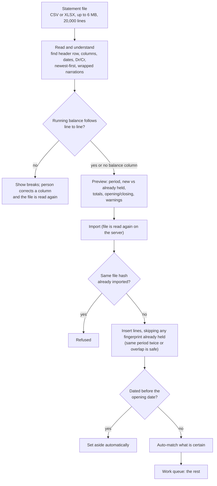

### 7.2 How Orion decides a match

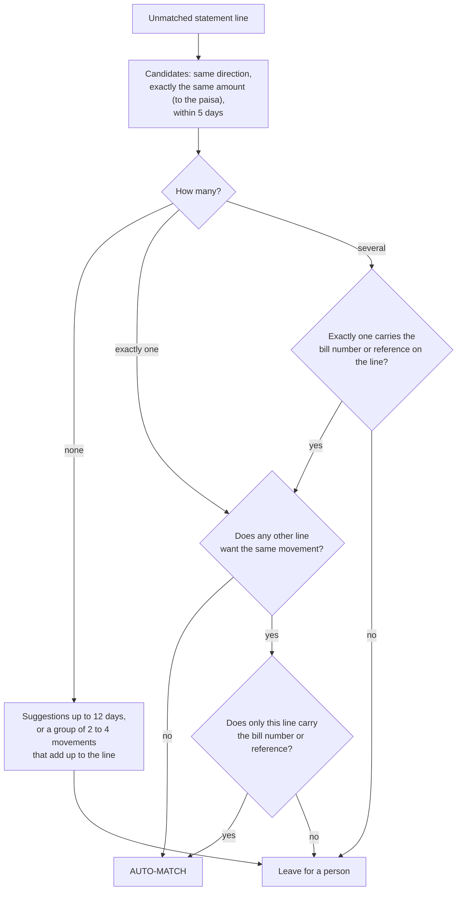

Orion never matches a close-but-different amount, and never matches money to a movement the other way round. Anything uncertain waits for a
click, with the reasons shown (days apart, bill number found, client name). A movement can be on one line at most (a database constraint).

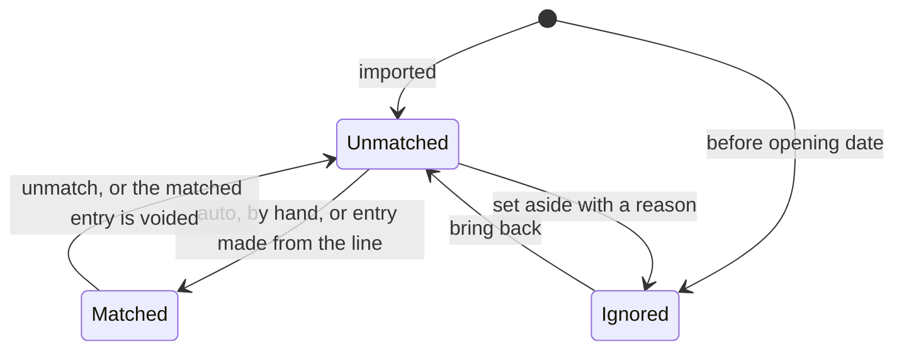

### 7.3 Does the book agree with the bank?

```
book balance on the statement date          =  opening balance + all movements up to that date
statement balance (last line with a balance) =  what the bank says

difference  = book - statement
explained by:
    + movements in the book that no line is matched to   (the bank does not show them yet)
    - statement lines that nothing in the book is matched to (the book does not hold them)
unexplained = book - (statement + book-only items - bank-only items)
```

| State | Meaning |
|---|---|
| **Reconciled** | Nothing is loose on either side |
| **Differences explained** | The balances differ, but exactly by the loose items; match or record them and the gap closes |
| **Does not add up** | Something is missing that is neither a loose movement nor a loose line: usually a wrong opening balance or an un-uploaded stretch of statement |

---

## 8. Reporting: the same rupee on different screens

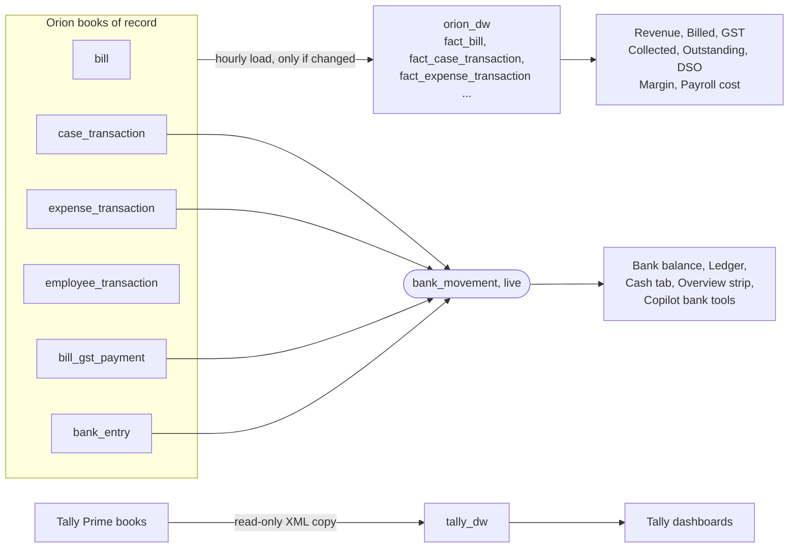

| Question | Screen | Reads | Basis and timing |
|---|---|---|---|
| What did we earn this month? | Orion dashboards > Revenue | `fact_bill.taxable_total` by service month | Accrual, before GST; as of the last warehouse load |
| What did we bill, with GST? | Orion dashboards > Revenue | `fact_bill.grand_total` | Accrual |
| What did clients pay us? | Collections > "Cash collected" | Committed `fact_case_transaction`, dated by received date | Cash, with GST; as of the last warehouse load |
| What do clients owe, and how old? | Outstanding page; Collections dashboard | `bill` less Committed receipts | Receivable; live (page) or last load (dashboard) |
| What is in the bank? | Bank > Overview; Cash tab | `bank_movement` | Cash book; **live** |
| How much interest did we earn? | Bank > Overview; Cash tab; Copilot | `bank_entry` kinds `interest`, `other_income` | Live |
| What is coming? | Bank > Overview forecast | `bank_expected` | Estimate from known Prospective lines |
| What do the accounting books say? | Tally dashboards | `tally_dw` | The accountant's books; refreshed by ETL |
| What is likely to happen over the next month to three years? | Forecast tab (Orion and Tally) | the same monthly series as above, through `app/forecast.py` | Statistical, at the present pace; learns from all history; as current as the warehouse |

**Why two revenue numbers can differ in a month.** "Revenue" (earned, by service month, before GST) is a different number from "Money in" (received
that month, with GST, whoever it was for). A July bill paid in September is revenue in July and money in September. That is correct, but it is the
first thing to explain to anyone comparing the Revenue tab with the Cash tab.

---

## 9. Controls

### 9.1 Who may do what

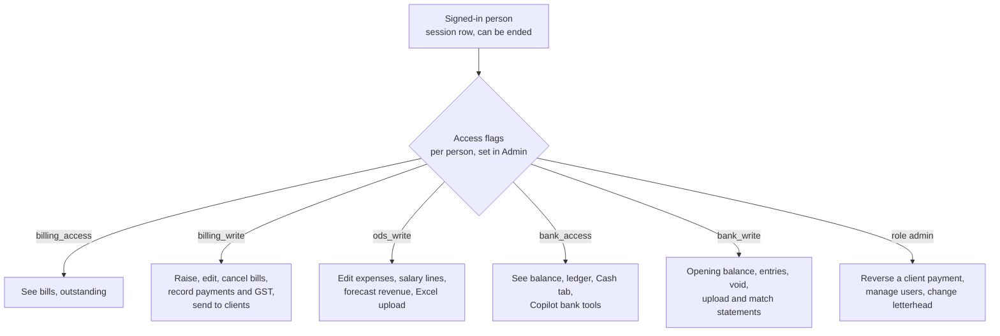

Bank access defaults to **admins only**; the first release gave it to nobody else. The permission is a dependency on every API route, so hiding a
button is only a convenience. The Copilot can read bank figures only for people with `bank_access`, cannot change the bank, and can create or edit
operational records only after the person confirms on screen.

### 9.2 What protects each kind of mistake

| Risk | Control | Where |
|---|---|---|
| Same request processed twice | `Idempotency-Key` claimed in the same transaction as the work: bills, payments, bank entries | `idempotency.py` |
| Two people change the same thing | Record version sent with the edit (409 if it moved); GST `seen_paid`; row locks on bills and bank lines | `entity_service.py`, `billing.py`, `bank.py` |
| An invoice number reused or changed | Number from a locked counter; never changed; a cancelled number stays on record | `billing.py` |
| A bill rewritten silently | Each edit needs a reason and keeps the old version whole | `bill_version` |
| GST payment recorded by accident | Confirmation tick, server `confirm`, no overpayment, reversal needs a reason; rows never deleted | `billing.record_gst_payment` |
| Money deleted | Bank entries are voided, GST payments reversed, bills cancelled, lines set aside: all kept | schema and code |
| Someone changes the bank's starting point | Confirmation with before and after balance; audited old/new | `bank.save_account` |
| A wrong automatic match | Auto-match only when certain both ways; every match is undoable and audited | `bank_match.auto_pairs` |
| Duplicate statement lines | Fingerprint unique per account; same file hash refused | `bank_statement.fingerprints` |
| Misreading a statement | Running-balance chain check; the file is re-read on the server; the person can remap columns | `bank_statement.py` |
| Spreadsheet formula injection in exports | Cells starting `= + - @` are prefixed | `bank.ledger_csv` |
| AI sends data out | Local model first; cloud only if policy allows **and** the person says yes for that request; long numbers masked | `ai/assist.py`, `bank_match.mask_numbers` |
| Who did it, and when | `created_by` / `last_updated_by`, `record_deleted`, `bank_audit`, bill versions, GST payment rows, `bill_message` | throughout |
| Losing the data | Encrypted daily backup of the database (the bank tables are in it) | `docs/backup.md` |

---

## 10. A worked example, end to end

**July 2026 service for a hospital.** Lines total 1,00,000; service charge 10 per cent; GST 9 per cent CGST + 9 per cent SGST.

| | Amount |
|---|---|
| Lines | 1,00,000 |
| Service charge 10% | 10,000 |
| **Taxable value** | **1,10,000** |
| CGST 9% | 9,900 |
| SGST 9% | 9,900 |
| **Grand total** | **1,29,800** |

| Day | Event | What Orion writes | Bank balance | Other effects |
|---|---|---|---|---|
| 31 Jul | Bill 2026-27/202 raised | `bill` v1; `case_transaction` **Prospective** 1,29,800 | no change | Revenue +1,10,000 (July); Outstanding +1,29,800; forecast shows 1,29,800 expected in; forecast shows GST 19,800 due 20 Aug |
| 5 Aug | Bill emailed | `bill_message` | no change | "last reminded" on Outstanding |
| 12 Sep | Client pays 1,27,600 (it deducted 2,200 TDS); the payment is recorded as cash 1,27,600 + TDS 2,200 | **Committed** line 1,29,800 (the whole bill), `received_date` 12 Sep; `bill_payment_deduction` TDS 2,200 (194C); no Prospective line is left | **+1,27,600** (the bank sees only the cash) | Collected in Sept: the bill is settled; Outstanding: 0; the 2,200 is in the TDS list to check against Form 26AS |
| 13 Sep | Statement uploaded | line "NEFT CR-HOSPITAL-INV 2026-27/202" 1,27,600 | no change | **Auto-matched** (same amount, one candidate, bill number on the line) |
| 20 Sep | GST paid, CGST and SGST together | `bill_gst_payment` x2 (one batch), 19,800 | **-19,800** | GST still to pay on this bill: 0; bill GST status Paid |
| 21 Sep | Bank interest credited | `bank_entry` interest 4,821.55 (made from the statement line) | **+4,821.55** | Interest and other income +4,821.55 |
| 30 Sep | Reconcile | | | State: Reconciled, if the opening balance is right |

Notice step three: the 2,200 TDS used to stay an open receivable for ever, because nothing in Orion said "this part was deducted as tax, not
unpaid" (finding 3 in section 12, now fixed). It is recorded with the payment, closes the bill, never reaches the bank, and waits in Utility > TDS to be
ticked when it appears in the client's Form 26AS.

---

## 11. How the modules are connected

| If this changes ... | ... this changes too |
|---|---|
| A bill is raised or edited | Its Prospective revenue line; Outstanding and ageing; the forecast; the warehouse copy at the next load (Revenue, Billed, GST) |
| A payment is recorded on a bill | A Committed line; the Bank balance, ledger, Cash tab and (if a matching statement line exists) its reconciliation; Collected; Outstanding |
| An admin reverses a payment | The line returns to Prospective; the bank balance falls; a statement line that was matched to it is **not** unmatched automatically (it will show the movement missing: the book no longer holds it) |
| GST is paid or reversed | `bill_gst_payment`; the bill's GST status; "GST to pay"; the bank balance and forecast |
| An expense is committed, edited or cancelled | Payables (what is owed and its ageing); the forecast (on its pay-by day, for what is unpaid); the Margin and Expense dashboards after the next load. **Not** the bank balance: that moves when a payment is recorded. A paid expense cannot be cancelled, or lowered below what was paid, until its payments are reversed |
| An expense payment is recorded or reversed | `expense_payment`; the expense's status (Unpaid / Part paid / Paid); the bank balance of the account, the ledger and the forecast |
| A salary line is entered | Payroll cost and "salary pending" on the dashboards; the forecast (unpaid lines at the month end). **Not** the bank balance |
| A month's salary is marked paid, or the pay run reversed | `salary_run`; the lines' `salary_paid` (and so the dashboards' "salary pending" after the next load); the bank balance of the account, the ledger and the forecast |
| A bank entry is added or voided | The balance, the ledger, Interest and other income; a matched statement line returns to unmatched on a void |
| The opening balance changes | Every balance, everywhere (confirmation required) |
| A statement is uploaded | Only `bank_statement_*` and `bank_match`; the balance never changes by an upload |
| The warehouse loads | The dashboards' figures (not the bank, which is live) |

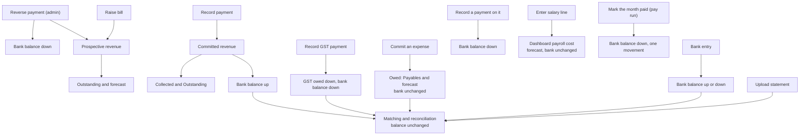

---

## 12. Assessment and what to improve

This is an honest review, from the seat of a finance leader at a large fintech who must sign off the numbers: what is already at a good standard,
and where I would not yet rely on the figures without a compensating control. Findings are ranked by how much money, or how much confidence in
the money, they put at risk.

### 12.1 What is already strong

- **Single source of truth.** The bank balance is derived, so it cannot disagree with the bills and expenses it is made of.
- **Immutability and history.** Bills (versions, permanent numbers), GST payments (reversal, never deletion), bank entries (void, never delete),
  statement lines and matches, all with who and when.
- **Idempotent money endpoints**, claimed in the same transaction as the work: the double-click and retry class of error is closed for bills,
  payments and bank entries.
- **Server-side enforcement and least privilege**: a route cannot be reached without its permission; bank access is admin-only by default.
- **A reconciliation that proves itself**: statement integrity check (running balance), fingerprints, certain-only auto-matching, and an equation
  that must close to zero.
- **Calculation parity tests** between what the screen shows and what the server bills.

### 12.2 Findings

| # | Finding | Why it matters | Severity | Recommendation |
|---|---|---|---|---|
| 1 | **Fixed: salary reaches the bank in pay runs.** ~~Salaries are not in the bank book or forecast.~~ `employee_transaction` fed payroll cost but not `bank_movement` or `bank_expected` | The balance overstated cash by every salary paid from the account, and reconciliation showed it as "statement line not in the book" each month | ~~High~~ | Done: `salary_run` (month, day, account, reference; reversal with a reason, never deleted) and `salary_run_id` on the lines; one `payroll` movement per run in `bank_movement`; unpaid lines in `bank_expected` at the month end; Bank > Payroll marks a month paid (one transfer, one run). Every line already paid was given a run on its own date, which counts in a balance only from the account's opening date |
| 2 | **Fixed: an expense is owed until a payment is recorded, and the bank counts payments.** ~~"Committed" expense means incurred, not paid.~~ The bank used to count a Committed expense as paid on its transaction date, with no due date, paid date or part payments | Vendor bills not yet paid reduced the balance early; part and late payments were invisible; there was no ageing of payables | ~~High~~ | Done: `expense_payment` (date, amount, account, reference, reversal with a reason, never deleted), a **Pay by** day on the expense, `bank_movement` reads payments and `bank_expected` reads what is unpaid, and Bank > Payables shows what is owed with ageing (not due, 0-30, 31-60, 61-90, over 90 days late). Every older Committed expense was given one full payment on its transaction date, so no balance moved |
| 3 | **Fixed: a payment is the cash that came in plus what the client held back (TDS, penalty, rounding, other).** ~~Short payments are not understood.~~ A client usually pays net of TDS (and sometimes penalties); the difference stayed "outstanding" for ever. Now the payment form takes the deductions, the bill closes when cash + deductions = what was open, the bank sees only the cash, and Utility > TDS keeps the TDS by financial year, client and quarter for matching to Form 26AS | ~~Overstated receivables, a false overdue (over 90 days) list, wrong DSO, and no TDS credit tracking~~ | ~~High~~ Fixed | The Orion dashboards show cash collected without the TDS and TDS held back on its own (after the next warehouse load); the 26AS tick is by hand (no 26AS import) |
| 4 | **Fixed: credit notes and bad-debt write-offs against a bill.** ~~No credit notes, write-offs or refunds.~~ A credit note (own series `CN 2026-27/1`, given on approval) takes money off what the client still owes, with the revenue and the GST in it, without changing the bill; it is made, then approved by someone other than its maker (or an admin), a write-off by an admin. Receivables, the bill list, the GST due, the Bank forecast, the dashboards' revenue, billed, GST and open amounts and Utility > GST all follow | ~~A disputed or short-paid bill cannot be corrected after payment~~ A credit note is for what is still unpaid: money already received cannot be credited back (a refund is a Bank entry) | ~~High~~ Fixed | A refund of money already received, a printable credit note, filing the note in the Document Center, and a GST payment already made beyond the reduced GST (reverse that payment first) |
| 5 | **No period close.** Any past bill, payment, expense or entry can be changed at any time. Reported figures for a closed month can change silently | A finance team cannot say "March is final"; audit and GST filing figures may shift after they were reported | **High** | Month-end lock: after close, changes need a reversing/adjusting entry in the open period, or an approved unlock. Keep a snapshot of each closed month's key figures |
| 6 | **Not double-entry; no chart of accounts, no trial balance.** Cash, receivables, GST and cost are separate systems of record | You cannot prove the books balance; accountants re-key into Tally; the two worlds are "allowed to differ" with no one measuring the difference | **Medium-high** | Either (a) a monthly **Orion-to-Tally reconciliation report** (revenue, GST, receipts, receivables by client: match and list differences), or (b) a posting layer that writes a balanced journal for each money event and exports vouchers to Tally |
| 7 | **No segregation of duties on the bank.** The same person can set the opening balance, add entries, import a statement, match lines and void | One person can create and conceal a discrepancy | **Medium-high** | Maker-checker: entries over a threshold, opening-balance changes and set-asides need a second person (the audit trail already has the data). Separate "prepare" and "approve" flags |
| 8 | **Fixed: a Committed revenue line with no bill is refused by the Transaction form, the Excel upload and the Copilot.** ~~Generic forms can create money without a bill.~~ It used to go straight into the bank book, with no idempotency key and no confirmation | It was the easiest way to put a wrong receipt in the balance and to bypass billing controls | ~~Medium-high~~ | Done: a database trigger (`case_transaction_committed_needs_bill`) refuses a new Committed line with no bill and a Prospective line made Committed; money with no bill is a Bank entry of kind `other_receipt` with a required note, voidable and idempotent; the Status field on the form says the effect on the balance. Older bill-less Committed lines are left as they are |
| 9 | **Half fixed: input tax credit is tracked, the return is not.** ~~GST is gross.~~ An expense that has GST now carries the supplier's GSTIN (check digit verified) and invoice number, and Utility > GST shows, by month, the GST on the bills less the credit on those costs (a surplus carries forward). Reverse charge, blocked credits, TCS, late fees, the supplier's own filing and the return itself (GSTR-3B) are not modelled, and the Bank forecast still expects the full GST on bills | ~~"GST to pay" overstates the net payable~~ The Bank forecast still does | **Medium** | Compute net payable per return period and record payments against the return; net the credit out of the forecast |
| 10 | **One account, no transfers, no cash.** By design for now | A second account or petty cash is a second silo; transfers between accounts would appear as unexplained lines | **Medium** | Support several accounts, with an inter-account transfer that is one transaction with two legs, and a petty-cash account counted by physical cash-up |
| 11 | **Partly fixed: a minimum balance can be set on an account, and Orion warns when the balance is below it or expected to be within two weeks.** The forecast showed the lowest week but nothing alerted | A shortfall is found by looking | ~~Medium~~ Low-medium | Done: the optional minimum on the Account tab, an Overview banner and a Copilot insight. Still to do: statement not uploaded for N days, unmatched lines older than N days |
| 12 | **Reconciliation depends on a manual statement upload** and on narration text | Delay and effort; narration varies by bank | **Medium** | Bank feeds (account aggregator or the bank's API) for automatic daily statements; match on UTR/reference when present; learn counter-party names from past matches |
| 13 | **Fixed: Reconcile now shows "Matched, then changed in the book" and the state no longer says reconciled over a broken match.** ~~A reversed or cancelled item that was already matched leaves a loose statement line.~~ Reversing a payment (admin) removes the receipt from the book, but the matching statement line keeps its match to a movement that no longer exists in the view | The reconciliation shows a movement missing only through the equation, not as a clear "matched item was reversed" exception | **Medium** | When a matched movement disappears from the view, surface it as an exception ("reversed after matching") and return the line to unmatched with a note |
| 14 | **Forecast is partial.** Statutory dues (PF/ESI/TDS), tax instalments and recurring bank charges are not in it; overdue is excluded by default | The forecast flatters the future (unpaid salary is now in it) | **Medium** | Add recurring commitments (salary, PF/ESI, rent, EMI) with a schedule; collection probability by client age; scenarios (best, expected, stress) |
| 15 | **Month-end timing and cut-off are implicit.** Revenue is by service month; receipts by received date; expenses by transaction date | Cut-off errors (a payment recorded the day after) move numbers between months | **Low-medium** | A cut-off report listing items entered after month end but dated inside it |
| 16 | **Partly fixed: adding an expense that looks like one already entered shows a warning first (it never blocks).** Numbers must be finite and the total must equal the parts, but there are no per-user limits or outlier checks | Typing errors and duplicates reach the books | ~~Low-medium~~ Low | Done: same type, case and amount within a week is warned about in the form, in the Excel upload result and in the Copilot's confirmation. Still to do: outlier warnings, per-role limits on single entries |
| 17 | **Restore has not been rehearsed** (decision deferred) | A backup that has never been restored is an assumption | **Medium** | A quarterly restore drill into a scratch database with row-count and balance checks (the bank balance is a handy control total) |
| 18 | **EPFO and ESIC: revenue when charged, a cost when paid.** A bill's EPFO and ESIC are inside its taxable value, so Revenue counts what was charged for them. **Resolved:** a payment recorded on the bill is a cost on the day paid (the view `orion_dw.expense_cost`), against the bill's case, independent of payroll and attendance, so Margin falls by it; the Bank already had it going out | Margin was overstated by what was paid over | **Medium** (resolved) | Remaining: the cost is counted when paid, not in the month the wages accrued (strict accrual would book it with the wages), and the employee's own share, paid in the same challan, is not tracked apart from the employer's |
| 19 | **A penalty or short payment by a client was not a cost.** The payment form let a client hold back a penalty, a short payment or rounding; the bill closed, Revenue stayed whole, and Margin did not fall. **Resolved:** each non-TDS deduction is now a cost on the day of the payment (the view `orion_dw.expense_cost`); TDS stays out (it is a tax credit) | Margin was overstated by every penalty and short payment | **Medium** (resolved) | Remaining: a penalty the client imposes without a payment (a deduction from a later bill) is a credit note, which already lowers Revenue |

### 12.3 A suggested order of work

| Phase | Theme | Items |
|---|---|---|
| **Now** (before relying on the balance) | Make the balance true | ~~1 (salary into the book)~~ done, ~~2 (expense paid dates)~~ done, ~~8 (close the bill-less revenue path)~~ done |
| **Next** (receivables you can trust) | Correct what clients owe | ~~3 (deductions and TDS)~~ done, ~~4 (credit notes and write-offs)~~ done, ~~13 (matched-then-reversed exception)~~ done |
| **Then** (finance close) | Provable books | 5 (period close), 6 (Orion-Tally reconciliation), 7 (maker-checker), 9 (input tax credit and net GST) |
| **Later** (scale) | Fewer hands, earlier warning | 10 (accounts and transfers), 11 and 14 (alerts, a fuller forecast), 12 (bank feeds), 15, 16, 17 |

### 12.4 Controls to keep, whatever is built next

These are the properties that make the current design trustworthy; any new money feature should keep them:

1. One writer per kind of money record, and never a second copy typed by hand.
2. Correct by adding a reversing record, never by overwriting or deleting.
3. Every money-changing request is processed once (idempotency) and carries who, when and why.
4. The server enforces permission and confirmation; the screen only helps.
5. A balance is derived and has an equation that must close to zero.
6. Anything uncertain waits for a person; automation acts only when it is certain both ways.
