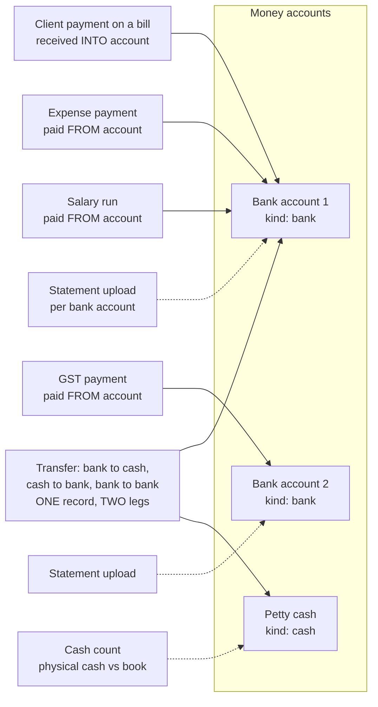

# Money hardening plan: fixing the 17 findings in three sessions

Source: section 12 of [money-flow.md](money-flow.md). Finding numbers below (#1 to #17) are that table's. Each session ends with merged pull requests, so a session
that runs short still leaves finished work behind: **one PR per item** (or per tightly linked pair), never one giant PR.

## How every item is done (the same checklist each time)

1. Branch from an up-to-date `main`; read `docs/change-impact.md` for the area first.
2. Schema change = a new or edited `.cursor/db/*.sql`, additive and re-runnable, added to **both** init scripts and `entities.SQL_MIGRATIONS`; the API restarted twice with no `Could not apply`.
3. Money-changing endpoints take an `Idempotency-Key`; every change is audited; nothing is deleted (reverse, void or supersede).
4. Tests first where the rule is arithmetic (pure tests, no database), then a `ORION_DB_TESTS=1` round trip, then a browser walk-through with a temporary `zz_` user.
5. `docs/features.md`, `change-impact.md`, `money-flow.md` (the finding is marked fixed) and `data-model.md` updated in the same PR.
6. Existing balances must not move on deploy unless the PR says so: each migration backfills so that today's bank balance and receivables are unchanged.

## Decisions (settled: "use best practice", and yes to several accounts and cash)

| # | Decision | What it means for the build |
|---|---|---|
| D1 | Salary is paid as **one bank transfer per pay run**; the paid date is the day the bank debited it | "Mark salary paid" takes a pay date, the account it was paid from and the bank reference, and marks the month's lines paid together. One movement per pay run, so one statement line matches it |
| D2 | Vendors may be paid **in instalments** | Expenses get a **payments table** (`expense_payment`: date, amount, account, reference; reversible, never deleted), exactly like GST payments. Status Unpaid / Part paid / Paid is derived. The bank sees each payment |
| D3 | TDS is **entered per payment** (amount and reason), with a **suggested rate per client** by section (for example 194C 1% or 2%, 194J 10%); quarterly matching against Form 26AS | `bill_payment_deduction` rows; a TDS receivable ledger by financial year and client, with a "matched to 26AS" tick per entry |
| D4 | A credit note needs **approval by someone other than its maker**; its own number series (`CN 2026-27/1`), never reused | Maker-checker, same engine as the bank's (session 2, item 3), so credit notes are built after it, or share it |
| D5 | **Maker-checker** on the bank: entries of ₹1,00,000 and above, every opening-balance change, every set-aside and every void of a matched item need a second person | `bank_approve` flag; the threshold is a setting on the Account tab |
| D6 | **Admins** close a month; reopening needs a reason and is audited and shown on the Overview | `period_lock` with reopen history |
| D7 | Expenses carry the **vendor's GSTIN and invoice number**: required for any expense that has GST from now on (GSTIN format and check digit validated), optional on old rows | Needed before input tax credit can be trusted |
| D8 | **Several bank accounts and cash (petty cash)** will exist | The foundation goes into session 1, not session 3: see "Several accounts and cash" below |

## Several accounts and cash: how it will work

Today there is one account, and nothing in a client payment, an expense or a GST payment says which account it touched. Adding accounts later would mean
guessing history, so the foundation goes in first, with a backfill that points everything existing at the one account that exists now (so no balance moves).

- **An account** has a kind (`bank` or `cash`), its own opening balance and date, and its own balance, ledger and reconciliation. The Bank page gets an account switcher and an "All accounts" total.
- **Every money event names its account.** Receiving a client payment asks "into which account" (default: the account last used for that client); paying an expense, GST or salary asks "from which account". New tables (`expense_payment`, salary pay runs) carry `account_id` from day one; `case_transaction` (receipts) and `bill_gst_payment` get a nullable `account_id`, backfilled to the existing account.
- **A transfer is one record with two legs** (`bank_transfer`: from, to, amount, date, reference, optional fee). It makes one movement out of one account and one in to another, so the total across accounts does not change, and each leg matches its own statement line. A cash withdrawal is bank to cash; a cash deposit is cash to bank.
- **Cash has no statement.** Its reconciliation is a **cash count**: someone counts the notes, Orion compares with the book, and any difference becomes an "over / short" entry that needs the second person's approval. Receipts and payments in cash are recorded through the same screens by choosing the cash account.
- **Reports**: the Cash dashboard tab and the forecast show the total and per-account balances; the low-balance alert is per account (a cash float and a current account need different floors).

---

## Until each fix lands: what to do by hand

| Finding | Interim practice |
|---|---|
| #1 salary | Done: mark a month paid in Bank > Payroll (one transfer, one pay run). Do not also enter a `Salary and wages` bank entry for it, or it counts twice |
| #2 expenses | Done: an expense reaches the bank when a payment is recorded in Bank > Payables. Mark an expense paid as it is paid; an expense entered as Committed and not marked paid is shown as owed, not as money out |
| #10 cash and second account | Until the foundation lands, record cash movements as Bank entries (`Other money in/out`) with a note, and keep a paper cash book; do not add a second account yet |
| #3 TDS | Done: record the cash received and the TDS held back together on the bill's payment form; the bill closes and the TDS waits in Utility > TDS for Form 26AS |
| #8 bill-less receipts | Done: the form refuses it. Record a client payment on its bill, and money with no bill as a Bank entry (receipt with no bill) |
| #7 control | A second person reviews the Bank "What has been done" history weekly |

---

## Session 1: make the balance true, and close the ways around billing

Goal: the bank balance matches the real bank without manual workarounds. Items: **#1, #2, #8, #13, #16 (duplicate expense warning)**, plus the small alert from **#11** (low balance).

| Order | Item | What gets built | Size |
|---|---|---|---|
| 0 | **#10 foundation**: money accounts | `bank_account.account_kind` (`bank` / `cash`); `account_id` on `bank_movement` (the view) and on every source: receipts (`case_transaction`) and `bill_gst_payment` get a nullable `account_id` backfilled to the existing account, new tables carry it from the start. An account switcher and "All accounts" total on the Bank pages; the account choice on "Record payment" and "Record GST payment" (default: the last used). No balance moves. Transfers and cash counts come in session 3 | M |
| 1 | **#13** matched-then-reversed exception | A query for `bank_match` rows whose movement is no longer in `bank_movement`; shown on Reconcile as "reversed after matching", with one click to return the line to unmatched with a note; counted in the Overview badge. No schema change. Quick win that also protects #1 and #2 | S |
| 2 | **#8** close the bill-less receipt path | The Transaction entity refuses `Committed` revenue with no `bill_code` from the form, the Excel upload and the Copilot (`entities.locked_reason`-style rule plus a database check `NOT VALID` for old rows). "Other receipt" becomes a Bank entry kind (`other_receipt`) with a reason. A "this changes the bank balance by ₹X" line on any form that still can | M |
| 3 | **#2** expense payments (instalments, D2) | New `due_date` on `expense_transaction` and a new table `expense_payment` (date, amount not above what is left, `account_id`, reference, reversal with a reason; never deleted), modelled on `bill_gst_payment`. **Backfill: every existing Committed expense gets one payment for its full amount on its `transaction_date`**, so no balance moves. `bank_movement` reads payments (not `transaction_date`); `bank_expected` reads what is still unpaid on `due_date`. Status Unpaid / Part paid / Paid is derived. Warehouse spec and `fact_expense_transaction` carry the new columns. A **Payables** page (what is owed, aged 0-30/31-60/61-90/90+) mirroring Outstanding, and "Record payment" on an expense with confirmation and an `Idempotency-Key` | L |
| 4 | **#1** salary into the bank book (D1) | New table `salary_run` (month, pay date, `account_id`, bank reference, total, who) and `salary_run_id` on `employee_transaction`. Backfill: lines already `salary_paid = 'Yes'` get one run per month, dated `transaction_date`. A new `payroll` branch of `bank_movement`, **one movement per run**, so one bulk transfer matches one statement line. `bank_expected` gets unpaid lines for the month-end, which also fixes half of #14. "Mark salary paid" (month, date, account, reference) replaces the bare Yes/No flip, with confirmation, `Idempotency-Key`, and reversal with a reason | L |
| 5 | **#16** duplicate warning | Entering an expense with the same vendor/type, amount and date within 7 days shows a confirm-to-continue warning (never blocks) | S |
| 6 | **#11** (part) low-balance alert | A Copilot insight and an Overview banner when the balance, or the 14-day projection, is below a floor set on the Account tab | S |

Definition of done: the Bank balance, ledger and forecast include salary and paid expenses; the four dev-DB bank figures are identical before and after the migration (checked in a test against a fixed fixture); the Reconcile exceptions list works; `money-flow.md` marks #1, #2, #8, #13 fixed.

Risks: the warehouse columns (the dashboards read `fact_expense_transaction`); deploy ordering (migration before the API restart, as always); the Excel template changes, so tell staff.

## Session 2: receivables you can trust, and controls on who can do what

Goal: what clients owe is true, and no single person can create and hide an error. Items: **#3, #4, #7, #9 (the tracking half)**.

| Order | Item | What gets built | Size |
|---|---|---|---|
| 1 | **#3** payment = cash + deductions | `billing.record_payment` takes deductions (`TDS`, `penalty`, `rounding`, `other`, each with an amount and a reason). New table `bill_payment_deduction` (kept for ever, reversible with the payment). Bill balance = total - received - deductions; the Prospective line shrinks by both; the **bank sees only the cash** (it already reads the Committed line). Outstanding, ageing, reminders and DSO use the new balance; the warehouse and dashboard formulas (`BILL_OPEN`, `fact_case_transaction`) get a deductions column. A **TDS receivable by financial year** page for matching Form 26AS. The 73 bill vectors are unchanged (this is not a billing calculation) | L |
| 2 | **#7** maker-checker on the bank | New flag `bank_approve`. Entries at or above the threshold, opening-balance changes, set-asides and voids go to **Pending** and count only once a different person approves; the maker cannot approve their own. Pending items shown on Overview; all audited. The Copilot cannot approve | M |
| 3 | **#4** credit notes and write-offs | New `credit_note` table and number series (`CN FY/seq`, from a locked counter like bills), linked to one bill, with taxable value and GST (CGST/SGST reversed), a reason, and approval by someone other than its maker (the engine from the previous item). A credit note reduces the bill's balance and reverses its revenue and GST in the dashboards; a **write-off** is a credit note of kind "bad debt" needing admin approval. Bill view shows them; receivables and GST owed follow. Printable PDF like a bill | L |
| 4 | **#9** (tracking half) input tax credit | Optional `vendor_gstin` and `vendor_invoice_no` on expenses; ITC = the expense's GST where a GSTIN is present; "GST payable" screens show output GST less ITC per month. The return filing itself stays outside Orion | M |

Definition of done: a bill paid net of TDS closes; a credit note reduces what is owed and revenue without breaking the bill's immutability; a second person is required for the controlled actions; `money-flow.md` marks #3, #4, #7 fixed and #9 half.

Risks: this is the most invasive session on billing (AGENTS.md rules for bills, payments and idempotency apply in full): one PR per item, bill vectors and `test_gst_paid.py` / `test_idempotency.py` must stay green, and the warehouse columns need a load before the dashboards show them.

## Session 3: provable books, scale, and earlier warning

Goal: someone outside can verify the books; the bank scales to several accounts and cash. Items: **#5, #6, #10 (the rest), #11, #14, #15, #17, and a decision on #12**.

| Order | Item | What gets built | Size |
|---|---|---|---|
| 1 | **#5** period close | `period_lock` table (month, closed by/at, reopened by/at/reason). After a close, the writers (`billing.py`, `bank.py`, `entity_service`) refuse changes dated inside a closed month and say to use an adjustment in the open period or an approved reopen. A snapshot of the month's key figures is stored at close | L |
| 2 | **#6** Orion-to-Tally reconciliation | A monthly report: revenue, GST, receipts and receivables by client, Orion against Tally, listing the differences with the bill numbers. Read-only, on its own tab under Tally dashboards | M |
| 3 | **#17** restore drill | A script and runbook: restore the latest encrypted backup into a scratch database, then check row counts per table and the bank balance against the live figure; a "last drill" date on the System page | S |
| 4 | **#15** cut-off report | Items entered after a month ended but dated inside it, per module | S |
| 5 | **#14** fuller forecast | Recurring commitments (rent, EMI, PF/ESI, statutory) with a schedule feeding `bank_expected`; collection probability by client ageing; best / expected / stress scenarios on the Bank forecast | M |
| 6 | **#11** (rest) alerts | Statement not uploaded for N days, unmatched lines older than N days, forecast breach, through the Copilot insights framework | S |
| 7 | **#10** accounts, transfers and cash (finishing what session 1's foundation started) | `bank_transfer` (one record, two legs: bank to bank, bank to cash, cash to bank, optional fee), each leg matching its own statement line; a **cash count** screen for cash accounts (counted vs book, the difference becomes an approved over/short entry); per-account statements, reconciliation and low-balance floors; the Cash dashboard tab and forecast with per-account and total views | L |
| 8 | **#12** bank feeds | A one-page options paper (account aggregator, the bank's API, or scheduled CSV drop) with cost, consent and security trade-offs. Build only after you pick a provider; this is the one item that may not fit in session 3 | S (paper) |

Definition of done: a closed month cannot change; the Tally reconciliation lists known differences; the restore drill has run once with a recorded result.

---

## Why this order

- **Session 1 first** because the balance is the number you act on, and every later item (alerts, reconciliation to Tally, close) assumes it is true.
- **Session 2** next because receivables and approvals change money rules that session 3's close and reconciliation then lock down. Locking a month before TDS and credit notes exist would freeze wrong numbers.
- **Session 3** last: it needs the earlier data to be correct before it can prove anything.

## If credits run short

Merge what is finished, and start the next session with: "read `docs/money-hardening-plan.md` and continue with the first item not marked done". Keep the status table below current at the end of each session.

## Status (update at the end of each session)

| Finding | Session | Status |
|---|---|---|
| #13 | 1 | **done**: `bank.exceptions` / `clear_exception`, the Reconcile panel, the Overview and Cash-tab counts, a reconciliation state that no longer says "reconciled" over a broken match |
| #8 | 1 | **done**: trigger `case_transaction_committed_needs_bill` (new Committed lines with no bill refused from the form, the Excel upload and the Copilot; older ones left alone), Bank entry kind `other_receipt` with a required note, a hint on the Status field |
| #2 | 1 | **done** (then "paid when entered", Paid On / Paid From / Payment Reference on the form and in Excel, and the Incurred / Planned words, added after use): `expense_payment` and `due_date`, backfill (no balance moved), `bank_movement` and `bank_expected` read payments, Bank > Payables (ageing, Pay, history, reverse), reconciliation follows the payment, the trigger `expense_keeps_its_payments`, the warehouse carries `due_date` |
| #1 | 1 | **done**: `salary_run` and `salary_run_id` on the lines, one `payroll` movement per run in the bank, unpaid salary in the forecast at month end, Bank > Payroll (Mark paid, Reverse), the lock on a paid line and the refusal to mark a line paid any other way, one run per month and date for every line already paid |
| #16, #11 (part) | 1 | **done**: duplicate-expense warning (form review step, Excel result, Copilot confirmation; never blocks) and the minimum balance on an account with an Overview banner and a Copilot insight. #11's other alerts (statement not uploaded, unmatched lines getting old) are in session 3 |
| #3 | 2 | **done**: `bill_payment_deduction` (`migrate_deductions.sql`, kept for ever, reversed with its payment), `billing.record_payment` takes `deductions` (TDS with section and rate, penalty, rounding, other), the revenue entry holds cash + deductions and the view `bank_movement` shows only the cash, a suggested section and rate per client, Utility > TDS by financial year, client and quarter with the Form 26AS tick (`tds.py`). The dashboards follow (cash collected without the TDS, a TDS held back figure, the collection rate on cash plus TDS). Not done: a 26AS import |
| #4 | 2 | **done**: `credit_note` (`migrate_credit_notes.sql`, kept for ever), `credit_notes.py` (made, approved by another person or an admin, a write-off by an admin, refused, withdrawn, reversed by an admin), `billing.apply_credit` / `unapply_credit` (the open entry, the bill's `credited_*` figures and the GST due), the numbering `CN 2026-27/n` on approval, Utility > Credit notes and the panel on a bill; receivables, the bill list, the Bank forecast, the dashboards and the GST position follow. Not done: a printable PDF, filing it in the Document Center, refunds of money already received. The approval engine is the credit notes' own (the bank's maker-checker, #7, is parked) |
| #7 | 2 | not started |
| #9 | 2 | **done (the tracking half)**: `vendor_gstin` and `vendor_invoice_no` on expenses (`migrate_input_tax_credit.sql`, in the warehouse too), required by the form, the Excel upload and the Copilot whenever an expense has GST (an older expense keeps its place until its GST changes), the GSTIN check digit (`gstin.py`), and Utility > GST: output GST, input tax credit, net by month (`gst_position.py`). Not done: the return period, reverse charge, netting the credit out of the forecast |
| #5 | 3 | not started |
| #6 | 3 | not started |
| #17, #15, #14, #11 (rest) | 3 | not started |
| #10 (foundation) | 1 | **done**: account kind, `account_id` on receipts, GST payments, entries and statement lines, per-account balances, ledger, statements and reconciliation, the switcher and the account choice on payment forms. Expenses and salary take an account when their own payments tables are built (items 3 and 4) |
| #10 (transfers, cash count, per-account everything) | 3 | not started |
| #12 | 3 | options paper only |
